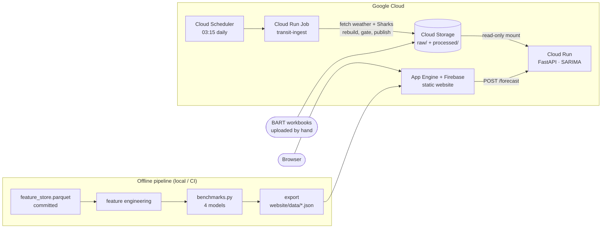

# Bay Area Transit Demand Forecasting

**CS163 Data Science Senior Project — Dhruv Shah**

Forecasts monthly ridership for all 50 BART stations, six months ahead, with
P10/P50/P90 uncertainty bands. Data ingestion and model inference both run on
Google Cloud.

| | |
| --- | --- |
| 🌐 **Website** | https://cs-163-final-project-tra-f1136.web.app (also on [App Engine](https://cs-163-final-project-tra-f1136.wl.r.appspot.com)) |
| 🗺 **Live map demo** | https://cs-163-final-project-tra-f1136.web.app/transit-demo.html |
| ⚡ **API playground** | https://cs-163-final-project-tra-f1136.web.app/api-demo.html |
| 🔌 **Forecast API** | https://transit-api-308878596074.us-west2.run.app/docs |

---

## Results

Scored on **Jul–Dec 2025**, a holdout no model or setting was chosen on: 300
station-months (50 stations × 6 months ahead), the same 300 for every model.
WAPE is the main metric because stations differ in size by about 100×.

| Model | WAPE | MAE (trips/month) | P10–P90 coverage (target 80%) |
| --- | ---: | ---: | ---: |
| **SARIMA (0,1,1)(0,1,1,12)** | **3.21%** | **3,086** | 96.7% |
| Prophet (per station) | 5.75% | 5,526 | 74.0% |
| Chronos-1 zero-shot (`chronos-t5-small`) | 9.70% | 9,321 | 84.7% |
| Seasonal naive ("same month last year") | 10.75% | 10,333 | 83.7% |

- **SARIMA is clearly best.** It beats Prophet at 46 and seasonal naive at 48 of
  50 stations, and its error does not grow with the horizon
  (2.6 / 2.5 / 3.3 / 3.5 / 4.4 / 2.9% for months 1–6).
- **Read it as 3–6%, not 3%.** The same model scores 6.36% on Jul–Dec 2024 and
  4.27% on Jan–Jun 2025; 3.21% is its best of the three half-years.
- **A small statistical model beat a foundation model.** With about 40 monthly
  points per station and strong yearly seasonality, the "airline" SARIMA
  (one trend difference, one seasonal difference, two parameters) outperforms
  Chronos-1, which runs zero-shot and without covariates.
- **Weather and Sharks games do not help at monthly resolution.** In a
  pre-registered experiment, adding observed weather to SARIMA raised WAPE to
  3.79% (worse at 42 of 50 stations); Sharks home games gave 3.19%,
  indistinguishable from noise (p = 0.54).
- **Reproducible.** Two runs of the benchmark are byte-identical; Prophet and
  Chronos are seeded.
- **Honest about intervals.** Point forecasts were never tuned on the test
  window; the interval calibration methods were revised after looking at it,
  so treat the coverage column with care. SARIMA's own band is over-wide and is
  published uncalibrated, labelled as such.

Full detail — calibration methods, Chronos caveats, the largest misses, and
superseded figures: [docs/results.md](docs/results.md).

## Data

- **Target:** monthly trips entering each BART station (BART's "Total Trips"
  origin–destination workbooks, summed over destinations). 50 stations ×
  60 months: 2019 and 2022–2025. 2020–21 is excluded because the pandemic broke
  every seasonal pattern.
- **Splits (chronological):** train Jan 2022 – Dec 2024, validation Jan – Jun
  2025, test Jul – Dec 2025.
- **Covariates:** Open-Meteo weather (hourly, aggregated to months) and San Jose
  Sharks home games (NHL API), joined by month. Months no archive covers are
  stored as unknown, not as zero.
- **What the data shows** (from the EDA notebook,
  `transit_eda/notebooks/eda_complete.ipynb`): ridership is still recovering —
  yearly totals were 35.0%, 40.5%, 43.1% and 47.3% of 2019 for 2022–2025 — and
  demand is concentrated: Embarcadero, Powell and Montgomery lead, and the four
  busiest stations carry 29.2% of all 2022–25 trips.

bart.gov blocks automated downloads (HTTP 403), so the BART workbooks are
downloaded by hand; their hashes are pinned in [data/MANIFEST.md](data/MANIFEST.md).
The merged feature store is committed (`data/processed/feature_store.parquet`).

## Architecture



- **Inference on Cloud Run.** A FastAPI service fits SARIMA per request and
  returns P10/P50/P90 for any station. It reads the latest store the ingest job
  published, checks its sha256, and falls back to the store baked into its
  image if anything is wrong. `GET /health` names the model and the store run it
  is serving.
- **Ingestion on Cloud Run Jobs.** Each day Cloud Scheduler starts a job that
  fetches new weather and Sharks data into Cloud Storage, rebuilds the feature
  store from the bucket, and publishes it only if a 10-check gate passes —
  including "ridership exactly equals the committed store" and "SARIMA still
  scores 3.21% on the holdout".
- **Least privilege.** Each component has its own service account with one role
  on one resource; the bucket is private and versioned.
- **Verified live.** `scripts/smoke_cloud.sh` passed 7 of 7 checks against the
  deployed system, including 50 live forecasts that reproduce 3.21% WAPE.

What it does **not** do: forecasts do not refresh nightly (new weather cannot
change a SARIMA forecast, which uses ridership only), and BART ingestion is
manual. A new month reaches the API once its workbook is uploaded to the bucket.

Infrastructure, deploy commands, the gate, and the bucket layout:
[docs/deployment.md](docs/deployment.md). API reference:
[docs/api.md](docs/api.md). Design rationale:
[docs/cloud-ingestion-design.md](docs/cloud-ingestion-design.md).

## Website and demos

A static React site in `website/` (no build step), served by App Engine and
Firebase. It reads JSON exported from the benchmark run, so every number on the
page comes from the data.

- **Results page:** the leaderboard, SARIMA's forecasts with their bands (a
  toggle shows Chronos-1), and the EDA.
- **Map demo:** all 50 BART stations on their real routes over Google Maps
  (falls back to OpenStreetMap if Google fails). "Forecast on Cloud Run" fetches
  a live forecast for the clicked station. The hour, day and weather sliders are
  illustrative and labelled so; the model is monthly.
- **API playground:** call the live API, or replay the Jul–Dec 2025 holdout to
  see forecasts against what actually happened.

## Quick start

Requires Python 3.14 (the pinned benchmark environment) and Git.

```bash
git clone https://github.com/Dhruv-cs50/transit-demand-forecasting.git
cd transit-demand-forecasting
python3.14 -m venv ~/.venvs/tdf-py314
source ~/.venvs/tdf-py314/bin/activate
pip install -r requirements-lock.txt
```

Reproduce the leaderboard from the committed feature store:

```bash
python Processing/feature_engineering.py      # enriched store + splits
python models/baselines/benchmarks.py         # 4 models -> evaluation/outputs/
python scripts/export_website_data.py --feature-store data/processed/feature_store_enriched.parquet
```

`benchmarks.py` writes `evaluation/outputs/benchmark_leaderboard.csv`; the export
regenerates `website/data/*.json`, which should come out byte-identical to the
committed files. The export is all-or-nothing: if any file fails, none is
replaced. Rebuilding the feature store itself needs the raw BART workbooks
(`machine_learning_files/bart_od_from_xlsx.py`, then `merge_pipeline.py`; see
[data/MANIFEST.md](data/MANIFEST.md)). `scripts/run_pipeline.sh` runs the whole
chain, including the standalone model scripts.

Tests (CI runs the same on every push, see `.github/workflows/ci.yml`):

```bash
python -m pytest --ignore=tests/test_api.py   # pipeline, models, ingest, export
```

The API and its tests run on Python 3.11 with `Dockerfile.api`'s pins; see
[docs/api.md](docs/api.md#run-and-test-locally).

## Repository layout

```text
configs/                 model.yaml (splits, horizon, quantiles), ingest.yaml (cloud job), sources.yaml
data/                    MANIFEST.md, processed/feature_store.parquet (committed)
machine_learning_files/  ingestion, merge pipeline, FastAPI service, cloud ingest job + gate
Processing/              feature engineering
models/baselines/        SARIMA, Prophet, seasonal naive, benchmark runner, covariate experiment
models/chronos2/         Chronos-1 zero-shot prediction
evaluation/              metrics, interval calibration, data validation
scripts/                 website export, pipeline runner, live cloud smoke test
website/                 static site, map demo, API playground
transit_eda/             EDA notebook (legacy/ holds a superseded script)
tests/                   pytest suite
docs/                    results, deployment, API, design and audit documents
```

## Documentation

| Document | Contents |
| --- | --- |
| [docs/results.md](docs/results.md) | Full results, three half-years, interval calibration, Chronos caveats |
| [docs/deployment.md](docs/deployment.md) | Cloud infrastructure, deploy commands, publish gate, bucket layout |
| [docs/api.md](docs/api.md) | Forecast API reference |
| [docs/ARCHITECTURE.md](docs/ARCHITECTURE.md) | Components and artifact contracts |
| [docs/DATA_PIPELINE.md](docs/DATA_PIPELINE.md) | Sources, rebuild steps, schema |
| [data/MANIFEST.md](data/MANIFEST.md) | Raw inputs, hashes, coverage |
| [docs/interval-calibration.md](docs/interval-calibration.md) | How each P10/P90 band was chosen |
| [docs/covariate-experiment.md](docs/covariate-experiment.md) | Do weather and events help? |
| [docs/cloud-ingestion-design.md](docs/cloud-ingestion-design.md) | Design of the cloud ingest job |
| [docs/review-2026-10-28.md](docs/review-2026-10-28.md) | Whole-project review and its findings |
| [docs/site-claims-audit.md](docs/site-claims-audit.md) | Every website claim traced to data |
| [docs/sprint-board.md](docs/sprint-board.md) | Delivery log |

## Limitations

- The model is monthly. Weather and events average out at that resolution; they
  would likely matter at hourly or daily resolution, which BART's public data
  does not provide here.
- BART workbooks are downloaded by hand, so new months arrive only when someone
  uploads them.
- The holdout is a single six-month window, and the interval methods were
  revised after looking at it; coverage figures are less reliable than the
  point-forecast figures.
- SARIMA's largest miss (Coliseum, 17.9%) comes from a one-off 2024 spike; an
  event indicator would address it, not a different model family.
- Chronos-1 runs univariate: its pipeline accepts no covariates.
