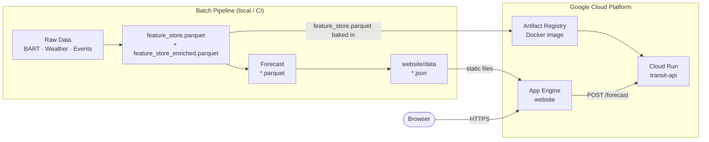

# Bay Area Transit Demand Forecasting

CS163 Data Science Senior Project - Dhruv Shah

**🌐 Website (App Engine):** https://cs-163-final-project-tra-f1136.wl.r.appspot.com

**🗺 Interactive Map Demo:** https://cs-163-final-project-tra-f1136.wl.r.appspot.com/transit-demo.html

**⚡ API Playground (interactive):** https://cs-163-final-project-tra-f1136.wl.r.appspot.com/api-demo.html

**🔌 FastAPI REST service:** https://transit-api-308878596074.us-west2.run.app/docs

---

Bay Area Transit Demand Forecasting is an end-to-end forecasting project for monthly BART station ridership. It builds a station-level feature store from public transit, weather, event, and calendar data; fits statistical forecasting models and runs a pretrained foundation model (Chronos-1) zero-shot; evaluates them on chronological splits; and exports the results to a static website hosted on Google App Engine.

The current production path models BART origin-destination ridership at a month-start cadence. The codebase also includes ingestion and feature hooks for broader Bay Area transit feeds, event calendars, weather covariates, and road context so the project can expand beyond the current monthly BART target.

## Highlights

- Monthly station-level BART ridership forecasting with chronological train, validation, and test splits.
- Weather (Open-Meteo) and San Jose Sharks home-game columns in the feature store, 2019–2023 only. No ranked model uses them yet (see the Chronos caveat below); Ticketmaster ingestion exists but needs a key.
- Baselines and model comparison across seasonal naive, SARIMA, Prophet and Chronos-1 zero-shot. AutoGluon fine-tuning code exists but has never produced a result (see below).
- Data validation for required columns, missing windows, station coverage, and ridership anomalies.
- Static website export that turns feature stores and model outputs into JSON consumed by the frontend.
- FastAPI service that fits the leaderboard's best model (SARIMA) per request for station forecasts.

## Current Results

Produced by a single `models/baselines/benchmarks.py` run against BART's actual
monthly trip counts, scored on **Jul–Dec 2025** — a holdout not used for model
selection. Each row of `website/data/model_comparison.json` carries `source`
and `scored_split` so any figure can be traced to the run that made it.

| Model | MAE | WAPE | Coverage (nominal 80%) | Model's own band | Interval | Predictions |
| --- | ---: | ---: | ---: | ---: | --- | ---: |
| SARIMA airline (0,1,1)(0,1,1,12) | 3,086 | 3.21% | 96.7% | 96.7% | own band (no method passed validation) | 300 |
| Prophet (per-station) | 5,526 | 5.75% | 74.0% | 46.0% | rolling-origin conformal, fit on data to Jun 2025 | 300 |
| Chronos-1 zero-shot (`chronos-t5-small`) | 9,321 | 9.70% | 72.7% | 51.0% | split-conformal, fit on validation | 300 |
| Seasonal naive | 10,333 | 10.75% | 83.7% | 94.3% | rolling-origin conformal (asymmetric), fit on data to Jun 2025 | 300 |

All models are scored on the same 300 station-months (50 stations × 6 forecast
steps). Reproduce with the four steps listed under "Reproduce The Pipeline"
below; `scripts/run_pipeline.sh` as a whole does not reproduce this table.

Prophet and Chronos both sample, so `configs/model.yaml` seeds them
(`prophet.seed`, `chronos2.seed`). Unseeded, Chronos moved between 8.06% and
9.70% WAPE and Prophet's coverage between 44% and 46% across otherwise
identical runs — a figure nobody can reproduce is not a result. Two consecutive
runs of the table above are bit-identical.

**Point accuracy is sound; interval calibration is not finished.** Only
seasonal naive's P10–P90 band landed in 75–85% on the holdout, and that is a
single six-month window:
- Seasonal naive's band is now fit to recent errors: a weighted conformal
  quantile over forecasts from every month since December 2023, wider above
  P50 than below. It covers 83.7%. Its own ±20% band covered 94.3% at more
  than twice the width.
- Prophet's and Chronos-1's own bands were far too narrow (46% and 51%
  coverage). Widened with conformal quantiles, they reach 74.0% and 72.7%,
  still short of 80%.
  Prophet's band is now also fit on the rolling pool, as one symmetric
  quantile for every month ahead; it scored 74.7% under the earlier
  single-window method. Chronos-1's misses all fall above P90.
- SARIMA's own band is too wide (96.7%). No calibration method passed
  validation for it, so it is published unchanged.
- Calibration never touches the point forecast: WAPE and MAE are identical
  with or without it.

Each method was chosen on data up to June 2025 only, under a rule fixed
before measuring. Errors shift from one half-year to the next, which limits
any calibration fit on the past. The comparison, the validation numbers each
choice rests on, and why the earlier Prophet MCMC attempt failed are in
[docs/interval-calibration.md](docs/interval-calibration.md).
The API serves SARIMA's own band and labels it in each response;
`website/data/forecasts.json` carries Chronos-1's split-conformal band (72.7%
test coverage). See
[Serving](docs/interval-calibration.md#serving).

**AutoETS (AutoGluon) carries no row, deliberately rather than silently.**
`autogluon.timeseries` requires Python <3.14 and cannot be installed here, and
no code path in this repository has ever emitted an AutoETS result. A
previously published figure of 14.2% WAPE was hand-entered, not computed.

Two caveats on the Chronos row:

- The pinned checkpoint is `amazon/chronos-t5-small`, which is Chronos-**1**.
  Earlier material called it "Chronos-2"; the leaderboard label is now derived
  from the checkpoint so it cannot drift again.
- It runs **univariate**. `ChronosPipeline.predict_df` takes no `future_df`, so
  the covariate path in `zero_shot.py` raises and every station falls back to
  no covariates. The 9.70% is a no-covariate result.

**Weather and Sharks games do not improve the forecast.** A separate, pre-registered
experiment (`models/baselines/covariate_experiment.py`, write-up in
[`docs/covariate-experiment.md`](docs/covariate-experiment.md)) adds them to the
SARIMA above as `exog` and changes nothing else. On the same test window, weather
(using the weather actually observed, a best case) raises WAPE from 3.21% to 3.79%,
worse at 42 of 50 stations; Sharks home games give 3.19%, a difference the paired
test cannot tell from noise (p = 0.54), and 4.63% against 4.27% on the validation
window (paired p = 0.20). These
are experiment rows, not leaderboard rows: the table above is unchanged.

`benchmarks.py` also refuses to publish what it did not measure: if
`chronos-forecasting` is absent the predictor silently falls back to seasonal
naive, and the row is omitted rather than credited to Chronos. Any model whose
WAPE exceeds 100% — worse than forecasting a flat zero — is rejected outright.

Earlier published figures (Prophet 176.3%, SARIMA 22.5%, AutoETS 14.2%) are
superseded. `benchmarks.py` could not execute at all — it failed on import — so
no leaderboard existed and the website export silently scored a different split.
See `updates/` for the audit trail.

## Repository Map

```text
.
|-- configs/
|   |-- model.yaml                 # cadence, split dates, horizon, quantiles, training config
|   `-- sources.yaml               # source endpoints, station coords, API-key placeholders
|-- data/
|   |-- raw/                       # source downloads and parsed raw artifacts
|   `-- processed/                 # feature stores, splits, and validation reports
|-- machine_learning_files/
|   |-- fetch_511_transit.py       # 511 SF Bay transit feed ingestion
|   |-- fetch_bart_od.py           # BART OD ridership report ingestion
|   |-- bart_od_from_xlsx.py       # BART OD parquet builder from the hand-downloaded bart.gov Ridership_YYYYMM.xlsx workbooks (see data/MANIFEST.md)
|   |-- bart_od_from_csv.py        # Legacy fallback from bart_clean.csv; has no Total block, so merge_pipeline.py rejects its output
|   |-- fetch_weather_openmeteo.py # Open-Meteo station weather ingestion
|   |-- fetch_events.py            # NHL and Ticketmaster event ingestion
|   |-- merge_pipeline.py          # raw sources -> feature_store.parquet + splits
|   |-- zero_shot.py               # Chronos zero-shot forecasts
|   |-- api.py                     # FastAPI forecast service
|   `-- requirements.txt           # Python dependencies
|-- Processing/
|   |-- feature_engineering.py     # derived weather, event, time, lag, and station features
|   `-- ablation.py                # covariate and event-day analysis
|-- evaluation/
|   |-- validators.py              # data quality checks
|   `-- metrics.py                 # MAE, RMSE, MAPE, WAPE, MASE, sMAPE, coverage
|-- models/
|   |-- baselines/                 # SARIMA, Prophet, benchmark runner, PeMS fetcher
|   `-- chronos2/                  # AutoGluon training, prediction, and saved outputs
|-- scripts/
|   |-- run_pipeline.sh            # end-to-end local pipeline
|   `-- export_website_data.py     # model artifacts -> website/data/*.json
|-- transit_eda/                   # EDA data, notebooks, and generated figures
|-- website/                       # static React/Babel frontend served by Google App Engine
`-- docs/                          # architecture and data-pipeline runbooks
```

## Modeling Scope

The active configuration in `configs/model.yaml` uses:

| Setting | Value |
| --- | --- |
| Granularity | monthly |
| Pandas frequency | `MS` |
| Target | BART station-month ridership |
| Context window | 24 months |
| Forecast horizon | 6 months |
| Train period | January 2022 through December 2024 (36 months) |
| Validation period | January 2025 through June 2025 |
| Test period | July 2025 through December 2025 |
| Forecast quantiles | P10, P50, P90 |

The merge pipeline aggregates BART OD records to origin station-month totals, joins monthly weather summaries, computes monthly event indicators, adds calendar features, and writes chronological splits.

## Setup

**Prerequisites:** Python 3.11, Git. AutoGluon needs Python below 3.14; the published benchmark (SARIMA, Prophet, Chronos-1) ran on Python 3.14 without it.

```bash
# Clone
git clone https://github.com/Dhruv-cs50/transit-demand-forecasting.git
cd transit-demand-forecasting

# Create virtual environment with Python 3.11
python3.11 -m venv .venv311
source .venv311/bin/activate        # Windows: .venv311\Scripts\activate

# Install dependencies
pip install --upgrade pip
pip install -r machine_learning_files/requirements.txt
```

**API keys** — before running source fetchers, edit `configs/sources.yaml`:

| Key | Required for | Notes |
| --- | --- | --- |
| `transit_511.api_key` | 511 SF Bay feed | Free at 511.org |
| `ticketmaster.api_key` | Event data | Free developer account |
| Open-Meteo | Weather data | No key required |
| PeMS | Road data | Manual download, CALTRANS account |

The pipeline works without these keys if you skip the corresponding fetchers — BART OD data (the core dataset) requires no API key, but bart.gov blocks automated downloads, so the Ridership workbooks are downloaded by hand (see `data/MANIFEST.md` and Troubleshooting).

## Reproduce The Pipeline

Run the complete local workflow from the repository root:

```bash
bash scripts/run_pipeline.sh
```

That script performs:

1. Build `data/processed/feature_store.parquet` and chronological splits.
2. Build `data/processed/feature_store_enriched.parquet`, then regenerate the
   chronological splits from it (step 1's splits are pre-enrichment and get
   overwritten here so `finetune.py` trains on the full enriched schema).
3. Validate the enriched feature store.
4. Run Chronos zero-shot forecasts.
5. Run SARIMA and Prophet baselines.
6. Train the AutoGluon time-series ensemble.
7. Run model benchmarks.
8. Export JSON files for the website.

**The published leaderboard does not come from this script.** It came from four
steps: `python machine_learning_files/bart_od_from_xlsx.py --zips <zips>` (see
`data/MANIFEST.md`), `merge_pipeline.py`, `Processing/feature_engineering.py`,
then `models/baselines/benchmarks.py`. The script runs under `set -e`, so where
AutoGluon is not installed (it cannot be on Python 3.14) step 6 stops it before
the benchmark runs; where AutoGluon is installed, the benchmark adds an
`AutoGluon_Ensemble` row the published table does not have.

For faster iteration, run individual steps:

```bash
source .venv311/bin/activate

python machine_learning_files/merge_pipeline.py
python Processing/feature_engineering.py
python evaluation/validators.py --input data/processed/feature_store_enriched.parquet --mode lenient --freq MS

python machine_learning_files/zero_shot.py
python models/baselines/arima.py
python models/baselines/prophet_baseline.py
python models/chronos2/finetune.py --time-limit 1800
python models/baselines/benchmarks.py

python scripts/export_website_data.py --feature-store data/processed/feature_store_enriched.parquet
```

## Important Artifacts

| Path | Description |
| --- | --- |
| `data/processed/feature_store.parquet` | merged station-month feature store — committed, and the only data the API reads (see [`data/MANIFEST.md`](data/MANIFEST.md)) |
| `data/processed/feature_store_enriched.parquet` | feature-engineered model input |
| `data/processed/splits/train.parquet` | training split |
| `data/processed/splits/val.parquet` | validation split |
| `data/processed/splits/test.parquet` | held-out test split |
| `data/processed/validation_report.csv` | latest validation summary |
| `models/chronos2/outputs/zero_shot_forecasts_*.parquet` | Chronos zero-shot forecasts written by `zero_shot.py`; not what the website publishes |
| `evaluation/outputs/chronos2_zeroshot_preds.parquet` | Chronos zero-shot test-window predictions written by `models/baselines/benchmarks.py` and scored on the leaderboard; the export reads them for `website/data/forecasts.json` and applies the saved calibrator to their band |
| `evaluation/outputs/calibration/calibrators/<model_key>.json` | fitted P10/P90 calibrators saved by `models/baselines/benchmarks.py` (fit on 2025-H1 validation forecasts); the export applies them, never refits |
| `models/baselines/outputs/arima/arima_forecasts.parquet` | SARIMA forecast artifact |
| `models/baselines/outputs/prophet/prophet_forecasts.parquet` | Prophet forecast artifact |
| `website/data/*.json` | static frontend data generated from model and feature artifacts |

## Live Deployment

| Service | URL |
| --- | --- |
| Website (App Engine) | https://cs-163-final-project-tra-f1136.wl.r.appspot.com |
| Interactive Map Demo | https://cs-163-final-project-tra-f1136.wl.r.appspot.com/transit-demo.html |
| API Playground | https://cs-163-final-project-tra-f1136.wl.r.appspot.com/api-demo.html |
| API (Cloud Run) | https://transit-api-308878596074.us-west2.run.app |
| API Docs (Swagger) | https://transit-api-308878596074.us-west2.run.app/docs |

The Cloud Run revision live at that URL was not built from this code. Checked
2026-10-22 (Pacific): it titles itself "Bay Area Traffic Forecast API … Chronos-2
powered" and answers `/forecast` from a Chronos cache for Jan–Jun 2024 on the
pre-Sprint-2 target definition (EM p50 1.16–1.45M riders/month, against 326–390k
actual for those months in the current feature store). The [Forecast API](#forecast-api) section describes
what `Dockerfile.api` builds; the live service matches it only after a rebuild
and redeploy.

## Cloud Deployment

### Infrastructure Overview

| Component | GCP Service | Details |
| --- | --- | --- |
| Website | App Engine Standard (`python312`) | Static file handlers, `website/` directory, `website/app.yaml` |
| API | Cloud Run | Serverless container, us-west2, auto-scales 0→N |
| Container image | Artifact Registry | `us-west2-docker.pkg.dev/<PROJECT_ID>/transit-repo/transit-api:tag1` |
| Build pipeline | Cloud Build | `cloudbuild.yaml` — builds `Dockerfile.api` for `linux/amd64` |

### Docker Containers

Two Dockerfiles are provided:

**`Dockerfile.api`** (inference service — used in production):
- Base: `python:3.11-slim`
- Copies `machine_learning_files/api.py`, `models/baselines/arima.py`, `evaluation/calibration.py` (picks and labels the P10/P90 band), `configs/model.yaml` and the committed `data/processed/feature_store.parquet` into the image, and installs `statsmodels` for SARIMA. No forecast cache, no `chronos-forecasting`: each `/forecast` fits SARIMA for the requested station (see [Forecast API](#forecast-api)).
- Builds from a clean clone — every file it copies is in git
- Exposes FastAPI on port `$PORT` (Cloud Run injects this env var)
- Build: `docker build -f Dockerfile.api -t transit-api .`

**`Dockerfile`** (full pipeline):
- Runs the complete ingestion → feature engineering → training → export pipeline
- Used for reproducing results locally or in batch compute environments

### Cloud Run Deployment

The API image is built and pushed via Cloud Build, then deployed to Cloud Run:

```bash
# Build and push via Cloud Build
gcloud builds submit --config=cloudbuild.yaml .

# Deploy to Cloud Run (manual after build)
gcloud run deploy transit-api \
  --image us-west2-docker.pkg.dev/<PROJECT_ID>/transit-repo/transit-api:tag1 \
  --platform managed \
  --region us-west2 \
  --allow-unauthenticated \
  --port 8080
```

### Cloud Data Storage

| Data | Location | Notes |
| --- | --- | --- |
| Feature store parquet | `data/processed/feature_store.parquet` (committed) | `Dockerfile.api` bakes it in; `api.py`'s `get_feature_store()` reads it at serve time. The enriched store is not in the image — only the offline pipeline (benchmarks, training, validation, website export) reads it |
| Docker images | Artifact Registry (`us-west2`) | Versioned container images for the API |
| Website assets | App Engine Standard | HTML/CSS/JSX/JSON, served via static file handlers |
| Forecasts | Not stored | Computed per request from the feature store; the image holds no forecast cache |

### System Design and Scalability



**Scalability:**
- **App Engine Standard** — auto-scales instances, zero when idle, no server management
- **Cloud Run** — scales 0→N replicas per concurrency, each replica stateless
- **Per-request SARIMA** — each `/forecast` is one small model fit (48 monthly points). In a local container one forecast took 0.03–0.6 s and the startup `statsmodels` import 1–17 s, on a laptop under heavy load from other work; neither has been measured on Cloud Run. The import happens at startup, so it lands on the cold start rather than the first request. Nothing is cached between requests

Full architecture diagram: [`docs/ARCHITECTURE.md`](docs/ARCHITECTURE.md)

## Website

The frontend is a static site in `website/`. It uses CDN-loaded React and Babel — no Node build step needed. The site reads generated JSON files from `website/data/`.

`website/data/forecasts.json` holds Chronos-1's Jul–Dec 2025 forecasts with its
split-conformal P10/P90 band, set from the model's errors on the Jan–Jun 2025
validation split. That band covered 72.7% of test actuals (51.0% for the
model's own band), still short of 80%. Each record also keeps the
model's own bounds as `p10_raw`/`p90_raw`, and an `interval_method` label that
matches the leaderboard's. Calibration never changes P50.

Live URL: **https://cs-163-final-project-tra-f1136.wl.r.appspot.com**

Refresh website data (after `models/baselines/benchmarks.py`, which saves the
fitted calibrator the export applies). If the export cannot match the
calibrator to the leaderboard, it writes the other files but not
`forecasts.json` (any previous one stays, now stale) and exits 1. The command:

```bash
python scripts/export_website_data.py --feature-store data/processed/feature_store_enriched.parquet
```

Deploy with App Engine:

```bash
gcloud app deploy website/app.yaml --quiet
```

## Forecast API

Live URL: **https://transit-api-308878596074.us-west2.run.app**

(See the note under [Live Deployment](#live-deployment): that URL still runs an
older image.)

The API serves **SARIMA airline (0,1,1)(0,1,1,12)**, the leaderboard's best
model. Each `/forecast` fits it for the requested station on demand with the
same functions `benchmarks.py` scores (`fit_station` / `predict_station` in
`models/baselines/arima.py`):

- **History:** months from `data.train_start` (2022-01) whose start is `<= as_of`.
  Without `as_of`, that is Jan 2022 through Dec 2025 (the store's 2019 months
  are never used), so the forecast covers Jan–Jun 2026.
- **What the 3.21% means here:** it is the holdout score of this spec trained
  through Jun 2025 (`"as_of": "2025-06-30"` reproduces those forecasts exactly).
  The default forecast, refit through Dec 2025, has not been scored — its months
  have no actuals yet.
- **Intervals:** P10/P90 are SARIMA's own band (nominal 80%). It is not
  calibrated, because no method passed validation. Its Jul–Dec 2025 holdout
  forecasts covered 96.7% of actuals — over-wide. Each response says so in its
  `interval` field (`"calibrated": false`, `"method": "none"`); see the output
  below.
- **`horizon_hours` counts months.** The name predates the monthly target; at
  most 6 rows come back.
- **Errors:** unknown station → `404`; malformed `as_of`, or one that leaves
  fewer than 24 months of history → `400`. If `configs/model.yaml` names a
  calibration method for SARIMA but no matching fitted calibrator ships with
  the API (missing, unreadable or stale) → `503`, so a raw band is never served
  under a calibrated label.

Code: `machine_learning_files/api.py`. Tests (`requirements.txt` lacks `pytest` and `httpx`):

```bash
pip install fastapi==0.115.0 pydantic==2.7.0 pandas==2.2.0 pyarrow==16.0.0 numpy==1.26.4 PyYAML==6.0.1 scipy==1.14.1 statsmodels==0.14.4 httpx pytest
python -m pytest tests/
```

Start locally (the feature store is committed, so no pipeline run is needed):

```bash
uvicorn machine_learning_files.api:app --reload --port 8000
```

Endpoints:

| Method | Path | Description |
| --- | --- | --- |
| `GET` | `/health` | Service health, served model, P10/P90 band label, feature-store load status |
| `GET` | `/stations` | List of forecastable station IDs |
| `POST` | `/forecast` | Request P10/P50/P90 quantile forecasts |
| `GET` | `/docs` | Swagger UI (interactive API explorer) |

**Input** (`POST /forecast`; `as_of` is optional):
```json
{ "station_id": "EM", "horizon_hours": 6 }
```

**Output** (`POST /forecast`). The forecast row and `generated_at` are from a
response (generated 2026-10-23 UTC) of an image built from `Dockerfile.api`
before `model` and `interval` were added; first of six rows shown, values
rounded here only. `model` and
`interval` are shown as the API now returns them for SARIMA:
```json
{
  "station_id": "EM",
  "horizon_hours": 6,
  "generated_at": "2026-10-23T03:31:46.115150Z",
  "model": "SARIMA(0, 1, 1)x(0, 1, 1, 12)",
  "interval": {
    "calibrated": false,
    "method": "none",
    "nominal_level": 0.8,
    "label": "raw: no method passed validation",
    "description": "SARIMA's own P10/P90 band (nominal 80%), not calibrated: no method passed validation."
  },
  "forecasts": [
    { "timestamp": "2026-01-01 00:00:00", "p10": 386519.9, "p50": 415136.9, "p90": 443753.8 }
  ]
}
```


## Documentation

Additional project documentation:

- [docs/ARCHITECTURE.md](docs/ARCHITECTURE.md) - system flow, components, and artifact contracts.
- [docs/DATA_PIPELINE.md](docs/DATA_PIPELINE.md) - source data, rebuild steps, schema notes, and troubleshooting.
- [machine_learning_files/README.md](machine_learning_files/README.md) - ML-script guide for ingestion, forecasting, and API usage.

## Known Limitations

- The active modeled target is monthly BART OD ridership. Some files describe future higher-frequency transit support, but the current reliable pipeline is monthly.
- Weather and event data are aggregated to the monthly modeling cadence, and both raw archives end in December 2023, so 2024–2025 rows (the test window included) have no weather and no games. No ranked model reads these columns.
- `scripts/run_pipeline.sh` assumes `.venv311/bin/python` exists.
- Chronos (benchmarks only; the API does not run it) defaults to `cpu` in `configs/model.yaml`; change it to `mps` on Apple Silicon or `cuda` on a GPU machine for faster inference.
- Some source fetchers require external credentials or manual data access.

## Troubleshooting

| Symptom | Fix |
| --- | --- |
| `Feature store not found` | Run `python machine_learning_files/merge_pipeline.py`. |
| `feature_store_enriched.parquet` missing | Run `python Processing/feature_engineering.py`. |
| `No BART OD files found` | bart.gov answers automated requests with HTTP 403, so `fetch_bart_od.py` cannot fill `data/raw/transit/bart/`. Download the Ridership workbooks by hand and run `python machine_learning_files/bart_od_from_xlsx.py --zips <zips>` (see `data/MANIFEST.md`). Do not use `bart_od_from_csv.py` for the pipeline: `merge_pipeline.py` rejects the months it builds. |
| AutoGluon import/install failures | Recreate the environment with Python 3.11. |
| Chronos device errors | Change `chronos2.device` in `configs/model.yaml`. |
| Website shows stale data | Re-run `scripts/export_website_data.py` before deploying. |
