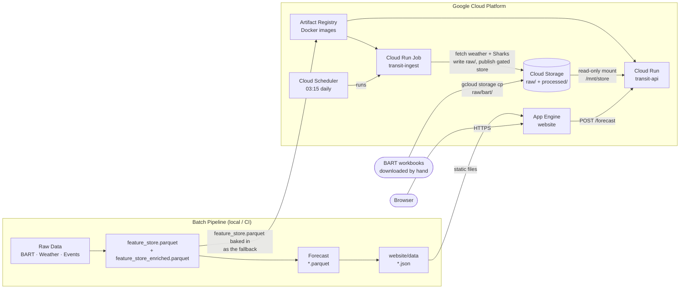

# Bay Area Transit Demand Forecasting

CS163 Data Science Senior Project - Dhruv Shah

**🌐 Website (App Engine):** https://cs-163-final-project-tra-f1136.wl.r.appspot.com

**🗺 Interactive Map Demo:** https://cs-163-final-project-tra-f1136.wl.r.appspot.com/transit-demo.html

**⚡ API Playground (interactive):** https://cs-163-final-project-tra-f1136.wl.r.appspot.com/api-demo.html

**🔌 FastAPI REST service:** https://transit-api-308878596074.us-west2.run.app/docs

---

Bay Area Transit Demand Forecasting is an end-to-end forecasting project for monthly BART station ridership. It builds a station-level feature store from public transit, weather, event, and calendar data; fits statistical forecasting models and runs a pretrained foundation model (Chronos-1) zero-shot; evaluates them on chronological splits; and exports the results to a static website hosted on Google App Engine.

The current production path models BART origin-destination ridership at a month-start cadence. The codebase also includes ingestion and feature hooks for broader Bay Area transit feeds, event calendars, weather covariates, and road context so the project can expand beyond the current monthly BART target.

## Highlights

- Monthly station-level BART ridership forecasting with chronological train, validation, and test splits.
- Weather (Open-Meteo) and San Jose Sharks home-game columns in the feature store: weather for every store month (2019, 2022–2025), Sharks games from September 2019 (see `data/MANIFEST.md`). No ranked model uses them yet (see the Chronos caveat below); Ticketmaster ingestion exists but needs a key.
- Baselines and model comparison across seasonal naive, SARIMA, Prophet and Chronos-1 zero-shot.
- Data validation for required columns, missing windows, station coverage, and ridership anomalies.
- Static website export that turns feature stores and model outputs into JSON consumed by the frontend.
- FastAPI service that fits the leaderboard's best model (SARIMA) per request for station forecasts, on Cloud Run.
- A Cloud Run Job on Cloud Scheduler that fetches Open-Meteo weather and the Sharks schedule into Cloud Storage, rebuilds the feature store from the bucket, validates it, and publishes it only if it passes; the API serves the latest published store. BART workbooks are downloaded and uploaded by hand, and weather and events do not change forecasts. See [Cloud Deployment](#cloud-deployment).

## Current Results

Produced by a single `models/baselines/benchmarks.py` run against BART's actual
monthly trip counts, scored on **Jul–Dec 2025**. No model, order or setting was
chosen on that window, so the point forecasts (P50, WAPE, MAE) are untuned to
it. The interval methods are not: they were revised after the test window had
been scored three times (Sprints 4–6, see
[docs/interval-calibration.md](docs/interval-calibration.md)), so read the
coverage column, Chronos-1's 84.7% especially, with that in mind. Each row of `website/data/model_comparison.json` carries `source`
and `scored_split` so any figure can be traced to the run that made it.

| Model | MAE | WAPE | Coverage (nominal 80%) | Model's own band | Interval | Predictions |
| --- | ---: | ---: | ---: | ---: | --- | ---: |
| SARIMA airline (0,1,1)(0,1,1,12) | 3,086 | 3.21% | 96.7% | 96.7% | own band (no method passed validation) | 300 |
| Prophet (per-station) | 5,526 | 5.75% | 74.0% | 46.0% | rolling-origin conformal, fit on data to Jun 2025 | 300 |
| Chronos-1 zero-shot (`chronos-t5-small`) | 9,321 | 9.70% | 84.7% | 51.0% | bias-shifted rolling-origin conformal, fit on data to Jun 2025 | 300 |
| Seasonal naive | 10,333 | 10.75% | 83.7% | 94.3% | rolling-origin conformal (asymmetric), fit on data to Jun 2025 | 300 |

All models are scored on the same 300 station-months (50 stations × 6 forecast
steps). Reproduce with the four steps listed under "Reproduce The Pipeline"
below.

**3.21% is SARIMA's best of three half-years.** The same specification, refit
at each origin, scores 6.36% WAPE on Jul–Dec 2024 (fit through Jun 2024,
coverage 80.3%), 4.27% on Jan–Jun 2025 (fit through Dec 2024, coverage 91.0%)
and 3.21% on Jul–Dec 2025. Read it as 3.2–6.4%. It beats Prophet at 46 and
seasonal naive at 48 of 50 stations on the test window, and its error does not
grow with the horizon (2.6 / 2.5 / 3.3 / 3.5 / 4.4 / 2.9% for months 1–6). The
largest miss is Coliseum (17.9%: August 2025 forecast 37% high after an
Aug–Sep 2024 spike). Source: the whole-project review,
[docs/review-2026-10-28.md](docs/review-2026-10-28.md).

Prophet and Chronos both sample, so `configs/model.yaml` seeds them
(`prophet.seed`, `chronos2.seed`). Unseeded, Chronos moved between 8.06% and
9.70% WAPE and Prophet's coverage between 44% and 46% across otherwise
identical runs — a figure nobody can reproduce is not a result. Two consecutive
runs of the table above are bit-identical.

**Point accuracy is sound; interval calibration is not finished.** Seasonal
naive's and Chronos-1's P10–P90 bands landed in 75–85% on the holdout;
Prophet's and SARIMA's did not, and that is a single six-month window:
- Seasonal naive's band is now fit to recent errors: a weighted conformal
  quantile over forecasts from every month since December 2023, wider above
  P50 than below. It covers 83.7%. Its own ±20% band covered 94.3% at more
  than twice the width.
- Prophet's and Chronos-1's own bands were far too narrow (46% and 51%
  coverage). Prophet's, widened with a conformal quantile, reaches 74.0%,
  still short of 80%. Its band is now also fit on the rolling pool, as one
  symmetric quantile for every month ahead; it scored 74.7% under the
  earlier single-window method.
- Chronos-1 under-forecast: with a band widened around P50 its misses all
  fell above P90 (72.7%). Its band is now re-centred on its recent median
  error for each month ahead (about 3.5% above P50 one month out, 9–10%
  further out) and widened by a conformal quantile. It covers 84.7%, with
  5.3% of actuals below P10 and 10.0% above P90, at 70% of the
  earlier width. October 2025 still covered only 56%.
- SARIMA's own band is too wide (96.7%). No calibration method passed
  validation for it, so it is published unchanged.
- Calibration never touches the point forecast: WAPE and MAE are identical
  with or without it.

Each method was chosen on data up to June 2025 only, under a rule fixed
before measuring. Errors shift from one half-year to the next, which limits
any calibration fit on the past. The comparison, the validation numbers each
choice rests on, and why the earlier Prophet MCMC attempt failed are in
[docs/interval-calibration.md](docs/interval-calibration.md).
The API serves SARIMA's own band and labels it in each response;
`website/data/forecasts_sarima.json` carries SARIMA's test forecasts with that
band (the site's default), and `website/data/forecasts.json` carries
Chronos-1's bias-shifted band (84.7% test coverage) behind a toggle. See
[Serving](docs/interval-calibration.md#serving).

Two caveats on the Chronos row:

- The pinned checkpoint is `amazon/chronos-t5-small`, which is Chronos-**1**.
  Earlier material called it "Chronos-2"; the leaderboard label is now derived
  from the checkpoint so it cannot drift again.
- It runs **univariate**. `ChronosPipeline.predict_df` takes no `future_df`, so
  the covariate path in `zero_shot.py` raises and every station falls back to
  no covariates. The 9.70% is a no-covariate result.

**Weather and Sharks games do not improve the forecast.** A separate, pre-registered
experiment (`models/baselines/covariate_experiment.py`, write-up in
[`docs/covariate-experiment.md`](docs/covariate-experiment.md)) adds them to the
SARIMA above as `exog` and changes nothing else. On the same test window, weather
(using the weather actually observed, a best case) raises WAPE from 3.21% to 3.79%,
worse at 42 of 50 stations; Sharks home games give 3.19%, a difference the paired
test cannot tell from noise (p = 0.54), and 4.63% against 4.27% on the validation
window (paired p = 0.20). These
are experiment rows, not leaderboard rows: the table above is unchanged.

`benchmarks.py` also refuses to publish what it did not measure: if
`chronos-forecasting` is absent the predictor silently falls back to seasonal
naive, and the row is omitted rather than credited to Chronos. Any model whose
WAPE exceeds 100% — worse than forecasting a flat zero — is rejected outright.

Earlier published figures (Prophet 176.3%, SARIMA 22.5%, and an AutoETS 14.2%
that was hand-entered, never computed) are superseded; the AutoGluon/AutoETS
code that never produced a result was removed in Sprint 8. `benchmarks.py` could not execute at all — it failed on import — so
no leaderboard existed and the website export silently scored a different split.
See `updates/` for the audit trail.

## Repository Map

```text
.
|-- configs/
|   |-- model.yaml                 # cadence, split dates, horizon, quantiles, training config
|   |-- ingest.yaml                # cloud ingest job: bucket, fetch window, pinned inputs, publish gate
|   `-- sources.yaml               # source endpoints, station coords, API-key placeholders
|-- data/
|   |-- raw/                       # source downloads and parsed raw artifacts
|   `-- processed/                 # feature stores, splits, and validation reports
|-- machine_learning_files/
|   |-- fetch_511_transit.py       # 511 SF Bay transit feed ingestion
|   |-- fetch_bart_od.py           # BART OD report downloader; bart.gov answers it with HTTP 403, so the pipeline uses bart_od_from_xlsx.py
|   |-- bart_od_from_xlsx.py       # BART OD parquet builder from the hand-downloaded bart.gov Ridership_YYYYMM.xlsx workbooks (see data/MANIFEST.md)
|   |-- bart_od_from_csv.py        # Legacy fallback from bart_clean.csv; has no Total block, so merge_pipeline.py rejects its output
|   |-- fetch_weather_openmeteo.py # Open-Meteo station weather ingestion
|   |-- fetch_events.py            # NHL and Ticketmaster event ingestion
|   |-- merge_pipeline.py          # raw sources -> feature_store.parquet + splits
|   |-- zero_shot.py               # Chronos zero-shot forecasts
|   |-- api.py                     # FastAPI forecast service; reads the cloud serving store, falls back to the baked one
|   |-- cloud_ingest.py            # Cloud Run Job entrypoint: fetch -> rebuild -> gate -> publish
|   |-- cloud_store.py             # storage abstraction: Cloud Storage (gs://) or a local directory (file://)
|   |-- ingest_fetch.py            # closed-month Open-Meteo and Sharks fetchers for the job
|   |-- ingest_gate.py             # the publish gate
|   `-- requirements.txt           # Python dependencies
|-- Processing/
|   |-- feature_engineering.py     # derived weather, event, time, lag, and station features
|   `-- ablation.py                # covariate and event-day analysis
|-- evaluation/
|   |-- validators.py              # data quality checks
|   `-- metrics.py                 # MAE, RMSE, MAPE, WAPE, MASE, sMAPE, coverage
|-- models/
|   |-- baselines/                 # SARIMA, Prophet, benchmark runner, PeMS fetcher
|   `-- chronos2/                  # Chronos-1 zero-shot prediction and saved outputs
|-- scripts/
|   |-- run_pipeline.sh            # end-to-end local pipeline
|   |-- smoke_cloud.sh             # read-only live check of the ingest job, the bucket and the API
|   `-- export_website_data.py     # model artifacts -> website/data/*.json
|-- transit_eda/                   # EDA notebook (eda_complete.ipynb) and data; legacy/ holds the superseded .py EDA
|-- website/                       # static React/Babel frontend served by Google App Engine
`-- docs/                          # architecture and data-pipeline runbooks
```

## Modeling Scope

The active configuration in `configs/model.yaml` uses:

| Setting | Value |
| --- | --- |
| Granularity | monthly |
| Pandas frequency | `MS` |
| Target | BART station-month ridership |
| Context window | 24 months |
| Forecast horizon | 6 months |
| Train period | January 2022 through December 2024 (36 months) |
| Validation period | January 2025 through June 2025 |
| Test period | July 2025 through December 2025 |
| Forecast quantiles | P10, P50, P90 |

The merge pipeline aggregates BART OD records to origin station-month totals, joins monthly weather summaries, computes monthly event indicators, adds calendar features, and writes chronological splits.

## Setup

**Prerequisites:** Python 3.14.0, Git. The published benchmark (SARIMA, Prophet, Chronos-1) is reproduced on the pinned environment in `requirements-lock.txt` (every package `==`-pinned, frozen on macOS arm64).

```bash
# Clone
git clone https://github.com/Dhruv-cs50/transit-demand-forecasting.git
cd transit-demand-forecasting

# Create the virtual environment with Python 3.14.0, outside /tmp
python3.14 -m venv ~/.venvs/tdf-py314
source ~/.venvs/tdf-py314/bin/activate

# Install the pinned dependencies
pip install -r requirements-lock.txt
```

Do not put the venv under `/tmp`: macOS cleanup deletes files there and leaves
a half-broken environment behind. A path outside the repo also keeps it out of
git (`.gitignore` only covers `.venv/` and `.venv311/`).

The lock omits the serving stack; the API tests use the separate install under
[Forecast API](#forecast-api).

**API keys** — before running source fetchers, edit `configs/sources.yaml`:

| Key | Required for | Notes |
| --- | --- | --- |
| `transit_511.api_key` | 511 SF Bay feed | Free at 511.org |
| `ticketmaster.api_key` | Event data | Free developer account |
| Open-Meteo | Weather data | No key required |
| PeMS | Road data | Manual download, CALTRANS account |

The pipeline works without these keys if you skip the corresponding fetchers — BART OD data (the core dataset) requires no API key, but bart.gov blocks automated downloads, so the Ridership workbooks are downloaded by hand (see `data/MANIFEST.md` and Troubleshooting).

## Reproduce The Pipeline

Run the complete local workflow from the repository root:

```bash
bash scripts/run_pipeline.sh
```

That script performs:

1. Build `data/processed/feature_store.parquet` and chronological splits
   (`merge_pipeline.py`; needs the raw BART workbooks under `data/raw/`, see
   `data/MANIFEST.md`).
2. Build `data/processed/feature_store_enriched.parquet` and regenerate the
   splits from it, then validate it.
3. Run Chronos zero-shot forecasts (`zero_shot.py`, a standalone artifact).
4. Run SARIMA standalone (writes `models/baselines/outputs/arima/standalone/`,
   so it never overwrites the benchmark's test forecasts).
5. Run Prophet standalone, then the model benchmarks.
6. Export JSON files for the website.

**The published leaderboard comes from four steps:** `python
machine_learning_files/bart_od_from_xlsx.py --zips <zips>` (see
`data/MANIFEST.md`), `merge_pipeline.py`, `Processing/feature_engineering.py`,
then `models/baselines/benchmarks.py`. The gate that checks every published
number (S7-13 in `docs/sprint-board.md`) starts at `feature_engineering.py`
from the committed store, because `data/raw/` is not in git.

For faster iteration, run individual steps. With only the committed store
(no raw workbooks), skip `merge_pipeline.py` and start at
`feature_engineering.py`:

```bash
source ~/.venvs/tdf-py314/bin/activate

python machine_learning_files/merge_pipeline.py   # needs data/raw/, see data/MANIFEST.md
python Processing/feature_engineering.py
python evaluation/validators.py --input data/processed/feature_store_enriched.parquet --mode lenient --freq MS

python machine_learning_files/zero_shot.py
python models/baselines/arima.py
python models/baselines/prophet_baseline.py
python models/baselines/benchmarks.py

python scripts/export_website_data.py --feature-store data/processed/feature_store_enriched.parquet
```

## Important Artifacts

| Path | Description |
| --- | --- |
| `data/processed/feature_store.parquet` | merged station-month feature store — committed, and the only data the API reads (see [`data/MANIFEST.md`](data/MANIFEST.md)) |
| `data/processed/feature_store_enriched.parquet` | feature-engineered model input |
| `data/processed/splits/train.parquet` | training split |
| `data/processed/splits/val.parquet` | validation split |
| `data/processed/splits/test.parquet` | held-out test split |
| `data/processed/validation_report.csv` | latest validation summary |
| `models/chronos2/outputs/zero_shot_forecasts_*.parquet` | Chronos zero-shot forecasts written by `zero_shot.py`; not what the website publishes |
| `evaluation/outputs/chronos2_zeroshot_preds.parquet` | Chronos zero-shot test-window predictions written by `models/baselines/benchmarks.py` and scored on the leaderboard; the export reads them for `website/data/forecasts.json` and applies the saved calibrator to their band |
| `evaluation/outputs/calibration/calibrators/<model_key>.json` | fitted P10/P90 calibrators saved by `models/baselines/benchmarks.py` (fit on 2025-H1 validation forecasts); the export applies them, never refits |
| `models/baselines/outputs/arima/arima_forecasts.parquet` | SARIMA forecast artifact |
| `models/baselines/outputs/prophet/prophet_forecasts.parquet` | Prophet forecast artifact |
| `website/data/*.json` | static frontend data generated from model and feature artifacts |

## Live Deployment

| Service | URL |
| --- | --- |
| Website (App Engine) | https://cs-163-final-project-tra-f1136.wl.r.appspot.com |
| Interactive Map Demo | https://cs-163-final-project-tra-f1136.wl.r.appspot.com/transit-demo.html |
| API Playground | https://cs-163-final-project-tra-f1136.wl.r.appspot.com/api-demo.html |
| API (Cloud Run) | https://transit-api-308878596074.us-west2.run.app |
| API Docs (Swagger) | https://transit-api-308878596074.us-west2.run.app/docs |

Firebase Hosting serves the same site at
https://cs-163-final-project-tra-f1136.web.app.

The API runs Cloud Run revision `transit-api-00003-rfb`: image
`transit-api:a156811`, deployed by digest `sha256:2d23c42f…` on 2026-10-28.
It serves the feature store that the cloud ingest job published, not the copy
baked into the image. Check what is live: `GET /health` returns
`store_source` (`cloud` or `baked`), `store_run_id` and `store_sha256`; on
2026-10-28 they read `cloud`, `20261028T084556Z-5e1329` and `f19f6051…`, and
`store_last_month` was `2025-12-01`. `scripts/smoke_cloud.sh` against this
service passed 7 of 7 checks, including 50 live `/forecast` calls at
`as_of=2025-06-30` that score 3.21% WAPE over 300 station-months.

Before 2026-10-28 the live revision was a May 2026 image that answered
`/forecast` with `No module named 'chronos'`; revision `transit-api-00002-cj7`
(`main` @ `abb0fe7`) replaced it, and `00003-rfb` replaced that. Both hosts
serve the committed `website/data/model_comparison.json`.

What the cloud pipeline does **not** do:

- **Forecasts do not refresh nightly.** Cloud Scheduler starts the ingest job
  at 03:15 every day, but the job only fetches 2026 weather and Sharks data,
  which no forecast reads (SARIMA reads `ridership` alone), and it publishes a
  new store only when its inputs change. Two runs triggered through Scheduler
  so far logged `unchanged` and exited 0. The API's forecast origin moves only
  when a new BART workbook is uploaded.
- **BART ingestion is manual.** bart.gov answers automated requests with
  HTTP 403, so someone downloads each workbook in a browser and uploads it to
  `raw/bart/`.
- **The cloud store is not byte-identical to the committed one.** The job
  builds on Python 3.11 / pandas 2.2; the committed store
  (`6cde32d4…`) was built on Python 3.14 / pandas 3. The job's gate checks
  that `ridership` is exactly equal and the covariates agree within `1e-9`,
  and the leaderboard, charts and website still read the committed store.

## Cloud Deployment

Design and rationale: [`docs/cloud-ingestion-design.md`](docs/cloud-ingestion-design.md).
Project `cs-163-final-project-tra-f1136`.

### Infrastructure Overview

| Component | GCP Service | Details |
| --- | --- | --- |
| Website | App Engine Standard (`python312`) | Static file handlers, `website/` directory, `website/app.yaml` |
| API | Cloud Run service `transit-api` (us-west2) | Serverless container, auto-scales 0→N; gen2, `--cpu-boost`; service account `transit-api` (`roles/storage.objectViewer` on the bucket only); the bucket is mounted read-only at `/mnt/store` and `SERVING_STORE_DIR=/mnt/store` |
| Data bucket | Cloud Storage `gs://cs-163-final-project-tra-f1136-transit-data` (us-west1) | Versioning on, public access prevented, uniform access, noncurrent versions deleted after 30 days. Holds `raw/` (BART, weather and events inputs) and `processed/` (published stores). See [Cloud Data Storage](#cloud-data-storage) |
| Ingest job | Cloud Run Job `transit-ingest` (us-west2) | Fetches closed-month weather and Sharks data, rebuilds the feature store from the bucket, gates it, publishes it if the gate passes. 1 CPU, 2 GiB, 15 min timeout, no retries; service account `transit-ingest` (`roles/storage.objectUser` on the bucket only) |
| Scheduler | Cloud Scheduler `transit-ingest-daily` (us-west2) | 03:15 America/Los_Angeles; POSTs to the job's `:run` endpoint as service account `transit-scheduler` (`roles/run.invoker` on the job only) |
| Container images | Artifact Registry (`us-west2`, repo `transit-repo`) | `transit-api:<commit>` and `transit-api:tag1`; `transit-ingest:<commit>` |
| Build pipeline | Cloud Build | `cloudbuild.yaml` builds `Dockerfile.api`; `cloudbuild.ingest.yaml` builds `Dockerfile.ingest`; both for `linux/amd64`. Neither deploys |
| Live smoke check | `scripts/smoke_cloud.sh` | Read-only: lists the job's latest execution, reads the pointer and its `gate.json`, calls the API's `/health`, `/stations` and `/forecast` |

BigQuery, Cloud Functions and Pub/Sub are not used.

### Docker Containers

Three Dockerfiles are provided:

**`Dockerfile.api`** (inference service — used in production):
- Base: `python:3.11-slim`
- Copies `machine_learning_files/api.py`, `models/baselines/arima.py`, `evaluation/calibration.py` (picks and labels the P10/P90 band), `configs/model.yaml` and the committed `data/processed/feature_store.parquet` into the image, and installs `statsmodels` for SARIMA. No forecast cache, no `chronos-forecasting`: each `/forecast` fits SARIMA for the requested station (see [Forecast API](#forecast-api)).
- The baked store is the fallback: the API uses it when `SERVING_STORE_DIR` is unset, or when the cloud store cannot be read or fails its sha256 check.
- Builds from a clean clone — every file it copies is in git
- Exposes FastAPI on port `$PORT` (Cloud Run injects this env var)
- Build: `docker build -f Dockerfile.api -t transit-api .`

**`Dockerfile.ingest`** (the `transit-ingest` job):
- Base: `python:3.11-slim`, `Dockerfile.api`'s library pins plus `openpyxl`, `requests` and `google-cloud-storage`
- Entrypoint `python -m machine_learning_files.cloud_ingest`; `--dry-run` and `--bucket file:///<dir>` run it against a local directory with no GCP
- Copies the committed store as the gate's reference

**`Dockerfile`** (full pipeline):
- Runs the complete ingestion → feature engineering → training → export pipeline
- Used for reproducing results locally or in batch compute environments

### Cloud Run Deployment

Tag every build with the commit, then deploy by digest so a revision names
exactly the image it runs (a tag can move; a digest cannot). These are the
commands of [`docs/cloud-ingestion-design.md`](docs/cloud-ingestion-design.md)
§5 with the choices the 2026-10-28 deployment recorded: `_TAG` set to the commit
(`a156811` there), `--cpu-boost`, and the API deployed by digest. The bucket,
service accounts and their IAM bindings are created once, as in §5.

```bash
P=cs-163-final-project-tra-f1136
R=us-west2
B=$P-transit-data
TAG=$(git rev-parse --short HEAD)
REPO=us-west2-docker.pkg.dev/$P/transit-repo

# Ingest job: build, deploy, schedule
gcloud builds submit --config=cloudbuild.ingest.yaml --substitutions=_TAG=$TAG .
gcloud run jobs deploy transit-ingest --image $REPO/transit-ingest:$TAG --region $R \
  --service-account transit-ingest@$P.iam.gserviceaccount.com --set-env-vars INGEST_BUCKET=gs://$B \
  --cpu 1 --memory 2Gi --task-timeout 15m --max-retries 0
gcloud run jobs add-iam-policy-binding transit-ingest --region $R \
  --member serviceAccount:transit-scheduler@$P.iam.gserviceaccount.com --role roles/run.invoker
gcloud scheduler jobs create http transit-ingest-daily --location $R \
  --schedule "15 3 * * *" --time-zone America/Los_Angeles \
  --uri https://run.googleapis.com/v2/projects/$P/locations/$R/jobs/transit-ingest:run --http-method POST \
  --oauth-service-account-email transit-scheduler@$P.iam.gserviceaccount.com

# API: build, then deploy by digest with the bucket mounted read-only
gcloud builds submit --config=cloudbuild.yaml --substitutions=_TAG=$TAG .
DIGEST=$(gcloud artifacts docker images describe $REPO/transit-api:$TAG \
  --format='value(image_summary.digest)')
gcloud run deploy transit-api --image $REPO/transit-api@$DIGEST --region $R \
  --service-account transit-api@$P.iam.gserviceaccount.com --execution-environment gen2 --cpu-boost \
  --add-volume name=store,type=cloud-storage,bucket=$B,readonly=true \
  --add-volume-mount volume=store,mount-path=/mnt/store --set-env-vars SERVING_STORE_DIR=/mnt/store \
  --allow-unauthenticated --port 8080
```

Run an ingest by hand (for example after uploading a BART workbook), then check
the system end to end:

```bash
gcloud run jobs execute transit-ingest --region $R --wait
API_URL=https://transit-api-308878596074.us-west2.run.app scripts/smoke_cloud.sh
```

`scripts/smoke_cloud.sh --local` checks a uvicorn on your machine and skips the
`gcloud` checks.

### Cloud Data Storage

| Data | Location | Notes |
| --- | --- | --- |
| Raw inputs | `gs://…-transit-data/raw/` | 22 objects on 2026-10-28: the 20 inputs the committed store was built from (BART zips and workbooks in `raw/bart/`, the 2019–2025 weather and events archives), plus `weather_all_stations_2026-01-01_2026-09-30.parquet` and `events_2026-01-01_2026-09-30.parquet`, which the job fetched. The job checks the 20 against sha256s pinned in `configs/ingest.yaml`. BART workbooks are uploaded by hand |
| Published stores | `gs://…-transit-data/processed/runs/<run_id>/` | `feature_store.parquet`, `gate.json` (every gate check) and `manifest.json`. Written once, never overwritten. The one run so far is `20261028T084556Z-5e1329` |
| Serving pointer | `gs://…-transit-data/processed/serving.json` | The only overwritten object: names the run the API serves (`run_id`, `store_object`, `store_sha256`, `input_fingerprint`, `published_at`). Written last, only after the gate passes |
| Baked feature store | `data/processed/feature_store.parquet` (committed) | Baked into the API image as the fallback. The leaderboard, `benchmarks.py` and the website export read it, directly or through the enriched store built from it. The enriched store is not in the image — only the offline pipeline (benchmarks, training, validation, website export) reads it |
| Docker images | Artifact Registry (`us-west2`) | Versioned container images for the API and the job |
| Website assets | App Engine Standard | HTML/CSS/JSX/JSON, served via static file handlers |
| Forecasts | Not stored | Computed per request from the feature store; the image holds no forecast cache |

### System Design and Scalability



**How the API gets its store:** if `SERVING_STORE_DIR` is set, the API reads
`processed/serving.json`, loads the parquet it names, and checks the sha256. Any
failure logs a warning and the API serves the baked store. It re-reads the
pointer every `STORE_TTL_SECONDS` (default 600) and swaps to a new `run_id`; a
failed reload keeps the current store. `/health` reports `store_source`,
`store_run_id` and `store_sha256`.

**What the job checks before it publishes** (all must pass; `gate.json` lists
each): the store passes `validate_feature_store` in strict mode; keys are
unique; every month has the same 50 stations; every key of the committed store
is present with `ridership` exactly equal and covariates within `1e-9`; no
served month disappears; no month is later than the last closed month; and
SARIMA fitted on the candidate at `as_of=2025-06-30` still scores 3.21% WAPE.
A failed gate exits 1 and leaves the pointer untouched.

**Scalability:**
- **App Engine Standard** — auto-scales instances, zero when idle, no server management
- **Cloud Run** — scales 0→N replicas per concurrency, each replica stateless
- **Per-request SARIMA** — each `/forecast` is one small model fit (48 monthly points). In a local container one forecast took 0.03–0.6 s and the startup `statsmodels` import 1–17 s, on a laptop under heavy load from other work; neither has been measured on Cloud Run. The import happens at startup, so it lands on the cold start rather than the first request. Nothing is cached between requests

Full architecture diagram: [`docs/ARCHITECTURE.md`](docs/ARCHITECTURE.md)

## Website

The frontend is a static site in `website/`. It uses CDN-loaded React and Babel — no Node build step needed. The site reads generated JSON files from `website/data/`.

`website/data/forecasts.json` holds Chronos-1's Jul–Dec 2025 forecasts with its
bias-shifted P10/P90 band, re-centred on the model's recent errors from
monthly forecasts made Dec 2023 – May 2025 and scored on actuals through June
2025. That band covered 84.7% of test actuals (51.0% for the model's own
band). Each record also keeps the
model's own bounds as `p10_raw`/`p90_raw`, and an `interval_method` label that
matches the leaderboard's. Calibration never changes P50.

Live URL: **https://cs-163-final-project-tra-f1136.wl.r.appspot.com**

Refresh website data (after `models/baselines/benchmarks.py`, which saves the
fitted calibrator the export applies). If the export cannot match the
calibrator to the leaderboard, it writes the other files but not
`forecasts.json` (any previous one stays, now stale) and exits 1. The command:

```bash
python scripts/export_website_data.py --feature-store data/processed/feature_store_enriched.parquet
```

Deploy with App Engine:

```bash
gcloud app deploy website/app.yaml --quiet
```

## Forecast API

Live URL: **https://transit-api-308878596074.us-west2.run.app**

The API serves **SARIMA airline (0,1,1)(0,1,1,12)**, the leaderboard's best
model. Each `/forecast` fits it for the requested station on demand with the
same functions `benchmarks.py` scores (`fit_station` / `predict_station` in
`models/baselines/arima.py`):

- **History:** months from `data.train_start` (2022-01) that have ended on or
  before `as_of` (a mid-month date leaves its own month out; a month-end date
  keeps it). Without `as_of`, that is Jan 2022 through Dec 2025 (the store's
  2019 months are never used), so the forecast covers Jan–Jun 2026. Those
  months had no actuals when the store was built; `/health` reports the store's
  last month as `store_last_month`.
- **What the 3.21% means here:** it is the holdout score of this spec trained
  through Jun 2025 (`"as_of": "2025-06-30"` reproduces those forecasts exactly).
  The default forecast, refit through Dec 2025, has not been scored — its months
  have no actuals yet.
- **Intervals:** P10/P90 are SARIMA's own band (nominal 80%). It is not
  calibrated, because no method passed validation. Its Jul–Dec 2025 holdout
  forecasts covered 96.7% of actuals — over-wide. Each response says so in its
  `interval` field (`"calibrated": false`, `"method": "none"`); see the output
  below.
- **`horizon_hours` counts months.** The name predates the monthly target. It
  defaults to 6; a larger request is clamped to 6, and the response echoes the
  number of rows returned and adds a `warnings` entry.
- **Non-finite bounds:** a NaN or infinite P10/P90 comes back as `null`, with a
  line in the top-level `warnings` list.
- **Errors:** unknown station → `404`; malformed `as_of`, or one that leaves
  fewer than 24 months of history → `400`. If `configs/model.yaml` names a
  calibration method for SARIMA but no matching fitted calibrator ships with
  the API (missing, unreadable or stale) → `503`, so a raw band is never served
  under a calibrated label.

Code: `machine_learning_files/api.py`. `tests/test_api.py` and
`tests/test_api_serving_store.py` need the serving
stack, which `requirements-lock.txt` leaves out, so it cannot be collected in
the Setup environment; the other tests in `tests/` run there. Run the API tests
in a separate Python 3.11 venv, the Python the API image is built on
(`python:3.11-slim` in `Dockerfile.api`), with the image's pins plus `httpx`
and `pytest`. The image's numpy, pandas, pyarrow, scipy and statsmodels pins
have no Python 3.14 wheels, so this set does not install in the Setup
environment:

```bash
python3.11 -m venv ~/.venvs/tdf-api-py311
source ~/.venvs/tdf-api-py311/bin/activate
pip install fastapi==0.115.0 "uvicorn[standard]==0.30.0" pydantic==2.7.0 pandas==2.2.0 pyarrow==16.0.0 numpy==1.26.4 PyYAML==6.0.1 scipy==1.14.1 patsy==1.0.1 statsmodels==0.14.4 httpx pytest
python -m pytest tests/test_api.py tests/test_api_serving_store.py
```

Start locally (the feature store is committed, so no pipeline run is needed):

```bash
uvicorn machine_learning_files.api:app --reload --port 8080
```

Endpoints:

| Method | Path | Description |
| --- | --- | --- |
| `GET` | `/health` | Service health, served model, P10/P90 band label, feature-store load status |
| `GET` | `/stations` | List of forecastable station IDs |
| `POST` | `/forecast` | Request P10/P50/P90 quantile forecasts |
| `GET` | `/docs` | Swagger UI (interactive API explorer) |

**Input** (`POST /forecast`; `as_of` is optional):
```json
{ "station_id": "EM", "horizon_hours": 6 }
```

**Output** (`POST /forecast`). The forecast row and `generated_at` are from a
response (generated 2026-10-23 UTC) of an image built from `Dockerfile.api`
before `model` and `interval` were added; first of six rows shown, values
rounded here only. `model` and
`interval` are shown as the API now returns them for SARIMA:
```json
{
  "station_id": "EM",
  "horizon_hours": 6,
  "generated_at": "2026-10-23T03:31:46.115150Z",
  "model": "SARIMA(0, 1, 1)x(0, 1, 1, 12)",
  "interval": {
    "calibrated": false,
    "method": "none",
    "nominal_level": 0.8,
    "label": "raw: no method passed validation",
    "description": "SARIMA's own P10/P90 band (nominal 80%), not calibrated: no method passed validation."
  },
  "forecasts": [
    { "timestamp": "2026-01-01 00:00:00", "p10": 386519.9, "p50": 415136.9, "p90": 443753.8 }
  ]
}
```


## Documentation

Additional project documentation:

- [docs/ARCHITECTURE.md](docs/ARCHITECTURE.md) - system flow, components, and artifact contracts.
- [docs/DATA_PIPELINE.md](docs/DATA_PIPELINE.md) - source data, rebuild steps, the cloud ingest job, schema notes, and troubleshooting.
- [docs/cloud-ingestion-design.md](docs/cloud-ingestion-design.md) - design of the cloud ingest job and how the API reads its store.
- [machine_learning_files/README.md](machine_learning_files/README.md) - ML-script guide for ingestion, forecasting, and API usage.

## Known Limitations

- The active modeled target is monthly BART OD ridership. Some files describe future higher-frequency transit support, but the current reliable pipeline is monthly.
- Weather and event data are aggregated to the monthly modeling cadence. Weather covers every store month, but it is observed weather, so for the Jul–Dec 2025 test window it is hindsight, not a forecast. The Sharks schedule starts on 2019-09-17, so the January–May 2019 games are missing; the store's eight 2019 months before September are unknown (`<NA>`/NaN), not months without a game. No ranked model reads these columns.
- `scripts/run_pipeline.sh` runs `.venv311/bin/python` if that file exists and `python3` from `PATH` otherwise. Activate the Setup venv before running it, and note that a leftover `.venv311/` in the repo takes precedence over the active venv.
- Chronos (benchmarks only; the API does not run it) defaults to `cpu` in `configs/model.yaml`; change it to `mps` on Apple Silicon or `cuda` on a GPU machine for faster inference.
- Some source fetchers require external credentials or manual data access.
- The cloud job does not make forecasts fresher on its own. Only a new BART workbook, uploaded by hand to `raw/bart/`, adds months or moves the API's default forecast origin (the served store ends at 2025-12); the weather and Sharks data it fetches are not read by any forecast.

## Troubleshooting

| Symptom | Fix |
| --- | --- |
| `Feature store not found` | Run `python machine_learning_files/merge_pipeline.py`. |
| `feature_store_enriched.parquet` missing | Run `python Processing/feature_engineering.py`. |
| `No BART OD files found` | bart.gov answers automated requests with HTTP 403, so `fetch_bart_od.py` cannot fill `data/raw/transit/bart/`. Download the Ridership workbooks by hand and run `python machine_learning_files/bart_od_from_xlsx.py --zips <zips>` (see `data/MANIFEST.md`). Do not use `bart_od_from_csv.py` for the pipeline: `merge_pipeline.py` rejects the months it builds. |
| Chronos device errors | Change `chronos2.device` in `configs/model.yaml`. |
| Website shows stale data | Re-run `scripts/export_website_data.py` before deploying. |
