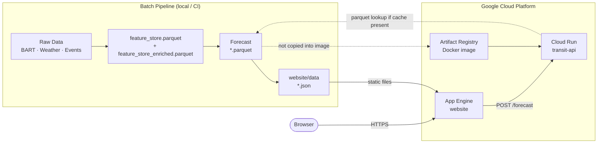

# Bay Area Transit Demand Forecasting

CS163 Data Science Senior Project - Dhruv Shah

**🌐 Website (App Engine):** https://cs-163-final-project-tra-f1136.wl.r.appspot.com

**🗺 Interactive Map Demo:** https://cs-163-final-project-tra-f1136.wl.r.appspot.com/transit-demo.html

**⚡ API Playground (interactive):** https://cs-163-final-project-tra-f1136.wl.r.appspot.com/api-demo.html

**🔌 FastAPI REST service:** https://transit-api-308878596074.us-west2.run.app/docs

---

Bay Area Transit Demand Forecasting is an end-to-end forecasting project for monthly BART station ridership. It builds a station-level feature store from public transit, weather, event, and calendar data; fits statistical forecasting models and runs a pretrained foundation model (Chronos-1) zero-shot; evaluates them on chronological splits; and exports the results to a static website hosted on Google App Engine.

The current production path models BART origin-destination ridership at a month-start cadence. The codebase also includes ingestion and feature hooks for broader Bay Area transit feeds, event calendars, weather covariates, and road context so the project can expand beyond the current monthly BART target.

## Highlights

- Monthly station-level BART ridership forecasting with chronological train, validation, and test splits.
- Weather (Open-Meteo) and San Jose Sharks home-game columns in the feature store, 2019–2023 only. No ranked model uses them yet (see the Chronos caveat below); Ticketmaster ingestion exists but needs a key.
- Baselines and model comparison across seasonal naive, SARIMA, Prophet and Chronos-1 zero-shot. AutoGluon fine-tuning code exists but has never produced a result (see below).
- Data validation for required columns, missing windows, station coverage, and ridership anomalies.
- Static website export that turns feature stores and model outputs into JSON consumed by the frontend.
- FastAPI service for station forecasts with cached-output and live-inference paths.

## Current Results

Produced by a single `models/baselines/benchmarks.py` run against BART's actual
monthly trip counts, scored on **Jul–Dec 2025** — a holdout not used for model
selection. Each row of `website/data/model_comparison.json` carries `source`
and `scored_split` so any figure can be traced to the run that made it.

| Model | MAE | WAPE | Coverage (nominal 80%) | Predictions |
| --- | ---: | ---: | ---: | ---: |
| SARIMA airline (0,1,1)(0,1,1,12) | 3,086 | 3.21% | 96.7% | 300 |
| Prophet (per-station) | 5,526 | 5.75% | 46.0% | 300 |
| Chronos-1 zero-shot (`chronos-t5-small`) | 9,321 | 9.70% | 51.0% | 300 |
| Seasonal naive | 10,333 | 10.75% | 94.3% | 300 |

All models are scored on the same 300 station-months (50 stations × 6 forecast
steps). Reproduce with `bash scripts/run_pipeline.sh`.

Prophet and Chronos both sample, so `configs/model.yaml` seeds them
(`prophet.seed`, `chronos2.seed`). Unseeded, Chronos moved between 8.06% and
9.70% WAPE and Prophet's coverage between 44% and 46% across otherwise
identical runs — a figure nobody can reproduce is not a result. Two consecutive
runs of the table above are bit-identical.

**Point accuracy is sound; interval calibration is not.** Prophet's p10–p90 band
covers 46% of actuals against a nominal 80%, and SARIMA's is over-wide at 96.7%.
Do not read either band as an 80% interval.

**AutoETS (AutoGluon) carries no row, deliberately rather than silently.**
`autogluon.timeseries` requires Python <3.14 and cannot be installed here, and
no code path in this repository has ever emitted an AutoETS result. A
previously published figure of 14.2% WAPE was hand-entered, not computed.

Two caveats on the Chronos row:

- The pinned checkpoint is `amazon/chronos-t5-small`, which is Chronos-**1**.
  Earlier material called it "Chronos-2"; the leaderboard label is now derived
  from the checkpoint so it cannot drift again.
- It runs **univariate**. `ChronosPipeline.predict_df` takes no `future_df`, so
  the covariate path in `zero_shot.py` raises and every station falls back to
  no covariates. The 9.70% is a no-covariate result.

`benchmarks.py` also refuses to publish what it did not measure: if
`chronos-forecasting` is absent the predictor silently falls back to seasonal
naive, and the row is omitted rather than credited to Chronos. Any model whose
WAPE exceeds 100% — worse than forecasting a flat zero — is rejected outright.

Earlier published figures (Prophet 176.3%, SARIMA 22.5%, AutoETS 14.2%) are
superseded. `benchmarks.py` could not execute at all — it failed on import — so
no leaderboard existed and the website export silently scored a different split.
See `updates/` for the audit trail.

## Repository Map

```text
.
|-- configs/
|   |-- model.yaml                 # cadence, split dates, horizon, quantiles, training config
|   `-- sources.yaml               # source endpoints, station coords, API-key placeholders
|-- data/
|   |-- raw/                       # source downloads and parsed raw artifacts
|   `-- processed/                 # feature stores, splits, and validation reports
|-- machine_learning_files/
|   |-- fetch_511_transit.py       # 511 SF Bay transit feed ingestion
|   |-- fetch_bart_od.py           # BART OD ridership report ingestion
|   |-- bart_od_from_xlsx.py       # BART OD parquet builder from the hand-downloaded bart.gov Ridership_YYYYMM.xlsx workbooks (see data/MANIFEST.md)
|   |-- bart_od_from_csv.py        # Legacy fallback from bart_clean.csv; has no Total block, so merge_pipeline.py rejects its output
|   |-- fetch_weather_openmeteo.py # Open-Meteo station weather ingestion
|   |-- fetch_events.py            # NHL and Ticketmaster event ingestion
|   |-- merge_pipeline.py          # raw sources -> feature_store.parquet + splits
|   |-- zero_shot.py               # Chronos zero-shot forecasts
|   |-- api.py                     # FastAPI forecast service
|   `-- requirements.txt           # Python dependencies
|-- Processing/
|   |-- feature_engineering.py     # derived weather, event, time, lag, and station features
|   `-- ablation.py                # covariate and event-day analysis
|-- evaluation/
|   |-- validators.py              # data quality checks
|   `-- metrics.py                 # MAE, RMSE, MAPE, WAPE, MASE, sMAPE, coverage
|-- models/
|   |-- baselines/                 # SARIMA, Prophet, benchmark runner, PeMS fetcher
|   `-- chronos2/                  # AutoGluon training, prediction, and saved outputs
|-- scripts/
|   |-- run_pipeline.sh            # end-to-end local pipeline
|   `-- export_website_data.py     # model artifacts -> website/data/*.json
|-- transit_eda/                   # EDA data, notebooks, and generated figures
|-- website/                       # static React/Babel frontend served by Google App Engine
`-- docs/                          # architecture and data-pipeline runbooks
```

## Modeling Scope

The active configuration in `configs/model.yaml` uses:

| Setting | Value |
| --- | --- |
| Granularity | monthly |
| Pandas frequency | `MS` |
| Target | BART station-month ridership |
| Context window | 24 months |
| Forecast horizon | 6 months |
| Train period | January 2022 through December 2024 (36 months) |
| Validation period | January 2025 through June 2025 |
| Test period | July 2025 through December 2025 |
| Forecast quantiles | P10, P50, P90 |

The merge pipeline aggregates BART OD records to origin station-month totals, joins monthly weather summaries, computes monthly event indicators, adds calendar features, and writes chronological splits.

## Setup

**Prerequisites:** Python 3.11, Git. AutoGluon needs Python below 3.14; the published benchmark (SARIMA, Prophet, Chronos-1) ran on Python 3.14 without it.

```bash
# Clone
git clone https://github.com/Dhruv-cs50/transit-demand-forecasting.git
cd transit-demand-forecasting

# Create virtual environment with Python 3.11
python3.11 -m venv .venv311
source .venv311/bin/activate        # Windows: .venv311\Scripts\activate

# Install dependencies
pip install --upgrade pip
pip install -r machine_learning_files/requirements.txt
```

**API keys** — before running source fetchers, edit `configs/sources.yaml`:

| Key | Required for | Notes |
| --- | --- | --- |
| `transit_511.api_key` | 511 SF Bay feed | Free at 511.org |
| `ticketmaster.api_key` | Event data | Free developer account |
| Open-Meteo | Weather data | No key required |
| PeMS | Road data | Manual download, CALTRANS account |

The pipeline works without these keys if you skip the corresponding fetchers — BART OD data (the core dataset) requires no API key, but bart.gov blocks automated downloads, so the Ridership workbooks are downloaded by hand (see `data/MANIFEST.md` and Troubleshooting).

## Reproduce The Pipeline

Run the complete local workflow from the repository root:

```bash
bash scripts/run_pipeline.sh
```

That script performs:

1. Build `data/processed/feature_store.parquet` and chronological splits.
2. Build `data/processed/feature_store_enriched.parquet`, then regenerate the
   chronological splits from it (step 1's splits are pre-enrichment and get
   overwritten here so `finetune.py` trains on the full enriched schema).
3. Validate the enriched feature store.
4. Run Chronos zero-shot forecasts.
5. Run SARIMA and Prophet baselines.
6. Train the AutoGluon time-series ensemble.
7. Run model benchmarks.
8. Export JSON files for the website.

For faster iteration, run individual steps:

```bash
source .venv311/bin/activate

python machine_learning_files/merge_pipeline.py
python Processing/feature_engineering.py
python evaluation/validators.py --input data/processed/feature_store_enriched.parquet --mode lenient --freq MS

python machine_learning_files/zero_shot.py
python models/baselines/arima.py
python models/baselines/prophet_baseline.py
python models/chronos2/finetune.py --time-limit 1800
python models/baselines/benchmarks.py

python scripts/export_website_data.py --feature-store data/processed/feature_store_enriched.parquet
```

## Important Artifacts

| Path | Description |
| --- | --- |
| `data/processed/feature_store.parquet` | merged station-month feature store |
| `data/processed/feature_store_enriched.parquet` | feature-engineered model input |
| `data/processed/splits/train.parquet` | training split |
| `data/processed/splits/val.parquet` | validation split |
| `data/processed/splits/test.parquet` | held-out test split |
| `data/processed/validation_report.csv` | latest validation summary |
| `models/chronos2/outputs/zero_shot_forecasts_*.parquet` | Chronos forecast artifacts |
| `models/baselines/outputs/arima/arima_forecasts.parquet` | SARIMA forecast artifact |
| `models/baselines/outputs/prophet/prophet_forecasts.parquet` | Prophet forecast artifact |
| `website/data/*.json` | static frontend data generated from model and feature artifacts |

## Live Deployment

| Service | URL |
| --- | --- |
| Website (App Engine) | https://cs-163-final-project-tra-f1136.wl.r.appspot.com |
| Interactive Map Demo | https://cs-163-final-project-tra-f1136.wl.r.appspot.com/transit-demo.html |
| API Playground | https://cs-163-final-project-tra-f1136.wl.r.appspot.com/api-demo.html |
| API (Cloud Run) | https://transit-api-308878596074.us-west2.run.app |
| API Docs (Swagger) | https://transit-api-308878596074.us-west2.run.app/docs |

## Cloud Deployment

### Infrastructure Overview

| Component | GCP Service | Details |
| --- | --- | --- |
| Website | App Engine Standard (`python312`) | Static file handlers, `website/` directory, `website/app.yaml` |
| API | Cloud Run | Serverless container, us-west2, auto-scales 0→N |
| Container image | Artifact Registry | `us-west2-docker.pkg.dev/<PROJECT_ID>/transit-repo/transit-api:tag1` |
| Build pipeline | Cloud Build | `cloudbuild.yaml` — builds `Dockerfile.api` for `linux/amd64` |

### Docker Containers

Two Dockerfiles are provided:

**`Dockerfile.api`** (inference service — used in production):
- Base: `python:3.11-slim`
- Copies the API source, `configs/model.yaml` and the feature-store parquets into the image. It does **not** copy `models/chronos2/outputs/` (gitignored, absent from a fresh checkout) and does not install `chronos-forecasting`, so the image ships with no forecast cache and no live-inference path: `/forecast` returns `503` for known stations until a cache is provided. This is a known gap.
- Exposes FastAPI on port `$PORT` (Cloud Run injects this env var)
- Build: `docker build -f Dockerfile.api -t transit-api .`

**`Dockerfile`** (full pipeline):
- Runs the complete ingestion → feature engineering → training → export pipeline
- Used for reproducing results locally or in batch compute environments

### Cloud Run Deployment

The API image is built and pushed via Cloud Build, then deployed to Cloud Run:

```bash
# Build and push via Cloud Build
gcloud builds submit --config=cloudbuild.yaml .

# Deploy to Cloud Run (manual after build)
gcloud run deploy transit-api \
  --image us-west2-docker.pkg.dev/<PROJECT_ID>/transit-repo/transit-api:tag1 \
  --platform managed \
  --region us-west2 \
  --allow-unauthenticated \
  --port 8080
```

### Cloud Data Storage

| Data | Location | Notes |
| --- | --- | --- |
| Feature store parquet | `data/processed/feature_store.parquet` + `data/processed/feature_store_enriched.parquet` | `Dockerfile.api` bakes in both, but the live API (`api.py`'s `get_feature_store()`, `zero_shot.py`'s `load_feature_store()`) reads only the pre-enrichment `feature_store.parquet` at serve time — the enriched file feeds offline training splits (`finetune.py`) instead |
| Docker images | Artifact Registry (`us-west2`) | Versioned container images for the API |
| Website assets | App Engine Standard | HTML/CSS/JSX/JSON, served via static file handlers |
| Pre-computed forecasts | Not in the image (known gap) | `models/chronos2/outputs/*.parquet` is gitignored and `Dockerfile.api` does not copy it; `api.py` reads it from the working directory when present |

### System Design and Scalability



**Scalability:**
- **App Engine Standard** — auto-scales instances, zero when idle, no server management
- **Cloud Run** — scales 0→N replicas per concurrency, each replica stateless
- **Pre-computed parquet cache** — when `models/chronos2/outputs/` holds a cache, `api.py` answers from a parquet lookup with no model load. `Dockerfile.api` ships no cache today, so the production image does not use this path (known gap)
- **Upgrade path** — `Dockerfile.api` (the production image) doesn't bundle `chronos-forecasting`, so a cache miss returns `503` today rather than running live inference; a local dev server started from `machine_learning_files/requirements.txt` (which does pin it) runs Chronos-T5-Small on CPU on cache miss — bundling it into `Dockerfile.api` and moving to GPU Cloud Run or Vertex AI is the upgrade path for live inference in production

Full architecture diagram: [`docs/ARCHITECTURE.md`](docs/ARCHITECTURE.md)

## Website

The frontend is a static site in `website/`. It uses CDN-loaded React and Babel — no Node build step needed. The site reads generated JSON files from `website/data/`.

Live URL: **https://cs-163-final-project-tra-f1136.wl.r.appspot.com**

Refresh website data:

```bash
python scripts/export_website_data.py --feature-store data/processed/feature_store_enriched.parquet
```

Deploy with App Engine:

```bash
gcloud app deploy website/app.yaml --quiet
```

## Forecast API

Live URL: **https://transit-api-308878596074.us-west2.run.app**

Model code: `machine_learning_files/api.py` (FastAPI service), `models/chronos2/finetune.py` (AutoGluon/Chronos training).

Start locally after building the feature store:

```bash
uvicorn machine_learning_files.api:app --reload --port 8000
```

Endpoints:

| Method | Path | Description |
| --- | --- | --- |
| `GET` | `/health` | Service health, model/store load status |
| `GET` | `/stations` | List of forecastable station IDs |
| `POST` | `/forecast` | Request P10/P50/P90 quantile forecasts |
| `GET` | `/docs` | Swagger UI (interactive API explorer) |

**Input** (`POST /forecast`):
```json
{ "station_id": "EMBR", "horizon_hours": 6 }
```

**Output** (`POST /forecast`):
```json
{
  "station_id": "EMBR",
  "horizon_hours": 6,
  "generated_at": "2025-06-01T12:00:00.000000Z",
  "forecasts": [
    { "timestamp": "2024-01-01", "p10": 42000, "p50": 58000, "p90": 74000 }
  ]
}
```

The API serves from cached parquet in `models/chronos2/outputs/` when present. That directory is not committed and `Dockerfile.api` does not copy it, so a fresh checkout and an image built from `Dockerfile.api` have no cache: every request takes the live-inference path (`amazon/chronos-t5-small`, i.e. Chronos-1). That path needs `chronos-forecasting`, which `Dockerfile.api` does not install, so `/forecast` returns `503` from that image; only a server installed from `machine_learning_files/requirements.txt` can run it.

## Documentation

Additional project documentation:

- [docs/ARCHITECTURE.md](docs/ARCHITECTURE.md) - system flow, components, and artifact contracts.
- [docs/DATA_PIPELINE.md](docs/DATA_PIPELINE.md) - source data, rebuild steps, schema notes, and troubleshooting.
- [machine_learning_files/README.md](machine_learning_files/README.md) - ML-script guide for ingestion, forecasting, and API usage.

## Known Limitations

- The active modeled target is monthly BART OD ridership. Some files describe future higher-frequency transit support, but the current reliable pipeline is monthly.
- Weather and event data are aggregated to the monthly modeling cadence, and both raw archives end in December 2023, so 2024–2025 rows (the test window included) have no weather and no games. No ranked model reads these columns.
- `scripts/run_pipeline.sh` assumes `.venv311/bin/python` exists.
- Chronos defaults to `cpu` in `configs/model.yaml` (suitable for Cloud Run); change it to `mps` on Apple Silicon or `cuda` on a GPU machine for faster inference.
- Some source fetchers require external credentials or manual data access.

## Troubleshooting

| Symptom | Fix |
| --- | --- |
| `Feature store not found` | Run `python machine_learning_files/merge_pipeline.py`. |
| `feature_store_enriched.parquet` missing | Run `python Processing/feature_engineering.py`. |
| `No BART OD files found` | bart.gov answers automated requests with HTTP 403, so `fetch_bart_od.py` cannot fill `data/raw/transit/bart/`. Download the Ridership workbooks by hand and run `python machine_learning_files/bart_od_from_xlsx.py --zips <zips>` (see `data/MANIFEST.md`). Do not use `bart_od_from_csv.py` for the pipeline: `merge_pipeline.py` rejects the months it builds. |
| AutoGluon import/install failures | Recreate the environment with Python 3.11. |
| Chronos device errors | Change `chronos2.device` in `configs/model.yaml`. |
| Website shows stale data | Re-run `scripts/export_website_data.py` before deploying. |
