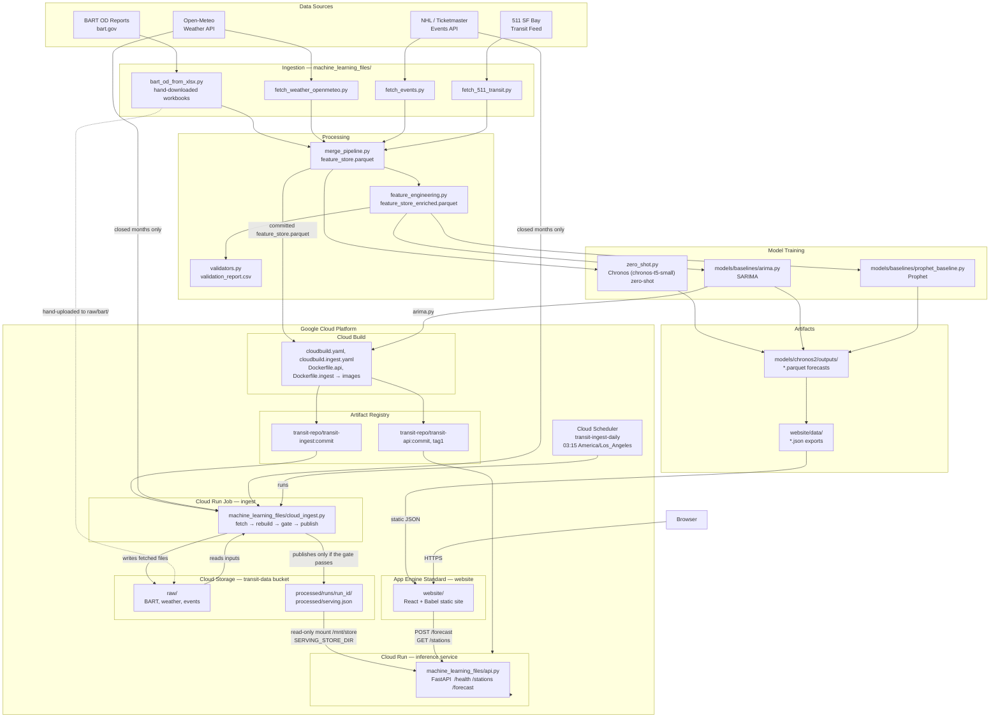

# Architecture

## System Diagram



## Component Responsibilities

| Component | Location | Responsibility |
| --- | --- | --- |
| Source configuration | `configs/sources.yaml` | API endpoints, station coordinates, venue IDs, key placeholders |
| Model configuration | `configs/model.yaml` | Granularity, split dates, context length, horizon, quantiles |
| Ingestion | `machine_learning_files/fetch_*.py`, `machine_learning_files/bart_od_from_xlsx.py` | Download source data into `data/raw/`; BART's workbooks are downloaded by hand and converted by `bart_od_from_xlsx.py` (bart.gov answers `fetch_bart_od.py` with HTTP 403) |
| Feature store | `machine_learning_files/merge_pipeline.py` | Build `data/processed/feature_store.parquet` and chronological splits |
| Feature engineering | `Processing/feature_engineering.py` | Add calendar, weather, event, lag, rolling, station covariates |
| Validation | `evaluation/validators.py` | Schema checks, missing windows, coverage, anomaly detection |
| Forecasting | `machine_learning_files/zero_shot.py`, `models/chronos2/`, `models/baselines/` | Produce forecast parquet files |
| Website export | `scripts/export_website_data.py` | Convert model artifacts into `website/data/*.json`. `forecasts.json` gets Chronos-1's bias-shifted P10/P90 band (the saved calibrator applied, never refit; 84.7% test coverage on one six-month window), the model's own bounds as `p10_raw`/`p90_raw`, and an `interval_method` label |
| API service | `machine_learning_files/api.py` | FastAPI: fits SARIMA (`models/baselines/arima.py`) for the requested station on each `/forecast` and returns P10/P50/P90, with an `interval` field saying which band P10/P90 is. Reads its feature store from the bucket's `processed/serving.json` when `SERVING_STORE_DIR` is set, else from the baked copy |
| Website | `website/` | React/Babel static frontend deployed on App Engine Standard |
| Docker (pipeline) | `Dockerfile` | Reproducible full pipeline container |
| Docker (serving) | `Dockerfile.api` | API image: `api.py`, `arima.py`, `evaluation/calibration.py` (picks and labels the band), config, the committed `feature_store.parquet` (the fallback store), and `statsmodels`. No forecast cache, no calibrator file, no `chronos-forecasting` |
| Cloud build | `cloudbuild.yaml`, `cloudbuild.ingest.yaml` | Build `Dockerfile.api` / `Dockerfile.ingest` for `linux/amd64` and push to Artifact Registry, tagged with the commit (`_TAG`); `transit-api` also keeps `:tag1`. Neither deploys |
| Docker (ingest) | `Dockerfile.ingest` | Job image: `Dockerfile.api`'s pins plus `openpyxl`, `requests`, `google-cloud-storage`; runs `python -m machine_learning_files.cloud_ingest` |
| Ingest job | `machine_learning_files/cloud_ingest.py`, `ingest_fetch.py`, `ingest_gate.py`, `cloud_store.py`, `configs/ingest.yaml` | Cloud Run Job `transit-ingest`: fetch closed-month Open-Meteo weather and Sharks games into `raw/`, rebuild the feature store from the bucket, gate it, publish `processed/runs/<run_id>/` and move `processed/serving.json` last. `cloud_store.py` hides Cloud Storage behind a directory-like interface so tests run on a local directory |
| Scheduler | Cloud Scheduler `transit-ingest-daily` | 03:15 America/Los_Angeles, POST to the job's `:run` endpoint as service account `transit-scheduler` |
| Data bucket | `gs://cs-163-final-project-tra-f1136-transit-data` (us-west1) | `raw/` inputs (BART uploaded by hand) and `processed/` published stores; versioning on, public access prevented, noncurrent versions deleted after 30 days |
| Live smoke check | `scripts/smoke_cloud.sh` | Read-only: checks the job's latest execution, the pointer and its `gate.json`, and the API's `/health` and `/forecast` |

## Data Flow

```
BART OD reports ──► bart_od_from_xlsx.py†      ──► data/raw/transit/bart/
Open-Meteo API  ──► fetch_weather_openmeteo.py ──► data/raw/weather/
Events APIs     ──► fetch_events.py            ──► data/raw/events/
                           │
                           ▼
                  merge_pipeline.py
                           │
                  feature_store.parquet (station × month × covariates)
                     │                 │
                     │ zero_shot.py    ▼
                     │ reads this      feature_engineering.py
                     │ file directly            │
                     │ (bypasses          feature_store_enriched.parquet
                     │  enrichment)             │
                     ▼                          ▼
                zero_shot            arima.py / prophet_baseline.py
                     │                          │
                     └────────────┬─────────────┘
                                  │
                  models/*/outputs/*.parquet
                           │
                           ▼
                  export_website_data.py        Dockerfile.api*
                           │                          │
                  website/data/*.json           Cloud Run API
                           │                          │
                           └────────────┬─────────────┘
                                        ▼
                                 App Engine Website
                                        │
                                     Browser
```

\* `Dockerfile.api` takes no forecast outputs. It bakes in `feature_store.parquet`
(committed) and `models/baselines/arima.py`, and the API fits SARIMA per request.
It takes no calibrator either: SARIMA's band is served raw, so none is read.

† bart.gov answers automated requests with HTTP 403, so the Ridership workbooks
are downloaded by hand (see `data/MANIFEST.md`) and converted by
`bart_od_from_xlsx.py`. `fetch_bart_od.py` exists but cannot download them.

### Cloud flow (serving store)

```
BART workbooks (by hand) ──► gcloud storage cp ──► raw/bart/ ─────────────┐
Open-Meteo, NHL (closed months, from 2026-01-01) ──► raw/weather, raw/events ─┤
                                                                           ▼
Cloud Scheduler 03:15 ──► Cloud Run Job transit-ingest:
        fingerprint raw/ ── equal to serving.json's input_fingerprint ──► "unchanged", exit 0
                     │
                     ▼ differs
        stage ► build_feature_store (Python 3.11 / pandas 2.2) ► gate
                     │
        gate fails ──► processed/runs/<id>/gate.json only, exit 1, pointer untouched
        gate passes ─► processed/runs/<id>/{feature_store.parquet, gate.json, manifest.json}
                       then processed/serving.json (last, generation-matched)
                                                                           │
Cloud Run service transit-api: /mnt/store (read-only mount) ◄──────────────┘
        re-reads serving.json every STORE_TTL_SECONDS (600); verifies sha256;
        on any failure serves the baked data/processed/feature_store.parquet
```

The job's fetchers read weather and Sharks data that the feature store carries as
covariate columns, but `merge_pipeline.build_feature_store` takes its rows from
the BART months, and the API's SARIMA reads only `ridership`. New weather or
Sharks data therefore cannot change a forecast; a new BART workbook can. The
benchmarks, `export_website_data.py` and the website keep reading the committed
`data/processed/feature_store.parquet` (through the enriched store built from it), not the cloud store.

## Artifact Contracts

### Feature Store Schema (minimum required columns)

| Column | Type | Meaning |
| --- | --- | --- |
| `timestamp` | datetime | Month start (`MS` cadence) |
| `station_id` | string | BART's two-letter workbook code for the OD origin station (`EM`, `12`); names, website ids and weather locations come from `machine_learning_files/bart_stations.py` |
| `station_name` | string | Human-readable station name |
| `ridership` | int | Monthly boardings (target variable) |
| `agency_id` | string | `BA` for BART |
| `transit_mode` | string | `rail` |

### API Endpoints

| Method | Path | Input | Output |
| --- | --- | --- | --- |
| GET | `/health` | — | `{status, timestamp, model, interval, store_loaded, store_last_month, store_source, store_run_id, store_sha256}` (`interval` is the band label; `store_source` is `cloud` or `baked`; `store_run_id` is `null` for the baked store, whose `store_sha256` is the baked file's; all four store fields are `null` until a store is loaded) |
| GET | `/stations` | — | `{stations: [station_id, ...], count}` |
| POST | `/forecast` | `{station_id, horizon_hours?, as_of?}` | `{station_id, horizon_hours, generated_at, model, interval: {calibrated, method, nominal_level, label, description}, forecasts: [{timestamp, p10, p50, p90}], warnings}` |

`horizon_hours` counts **months** (the name predates the monthly target). It
defaults to 6 and accepts 1–168; at most 6 rows come back, so a larger request is
clamped to 6 with a `warnings` entry, and the response's `horizon_hours` is the
number of rows returned. `as_of` picks the history: months that have ended on or
before it (a month counts once its last day is `<= as_of`), from `data.train_start`
on; a month-end date keeps its own month, a mid-month date leaves it out. Fewer
than 24 such months is a `400`; an unknown station is a `404`. A NaN or infinite
P10/P90 is returned as `null` with a `warnings` line.

`interval` says which P10/P90 band the response carries; `label` is the
leaderboard's `Interval_method` string. Today it is SARIMA's own band (nominal
80%), not calibrated because no method passed validation (`calibrated: false`,
`method: "none"`). If `configs/model.yaml` names a method for SARIMA and no
matching saved calibrator is in the image, `/forecast` returns `503` rather than
serve the raw band under a calibrated label. See
[interval-calibration.md](interval-calibration.md#serving).

### Chronological Splits

| Split | Period |
| --- | --- |
| Train | Jan 2022 – Dec 2024 |
| Validation | Jan 2025 – Jun 2025 |
| Test | Jul 2025 – Dec 2025 |

## Scalability

| Service | Scaling behaviour |
| --- | --- |
| App Engine Standard | Auto-scales instances; scales to zero when idle |
| Cloud Run | Scales 0→N replicas per request concurrency; stateless |
| Per-request SARIMA | One small fit per `/forecast`: 0.03–0.6 s in a local container on a heavily loaded laptop; the `statsmodels` import (1–17 s there) runs at startup. Not measured on Cloud Run. No forecast cache |
| Cloud Run Job | A daily trigger starts one execution. The pointer is written with a generation precondition, so a second publisher that loses the race exits 3 instead of overwriting. A run whose inputs are unchanged is a no-op that exits 0 |
