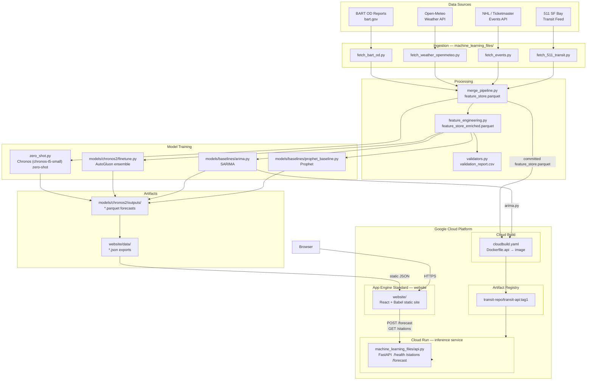

# Architecture

## System Diagram



## Component Responsibilities

| Component | Location | Responsibility |
| --- | --- | --- |
| Source configuration | `configs/sources.yaml` | API endpoints, station coordinates, venue IDs, key placeholders |
| Model configuration | `configs/model.yaml` | Granularity, split dates, context length, horizon, quantiles |
| Ingestion | `machine_learning_files/fetch_*.py` | Download source data into `data/raw/` |
| Feature store | `machine_learning_files/merge_pipeline.py` | Build `data/processed/feature_store.parquet` and chronological splits |
| Feature engineering | `Processing/feature_engineering.py` | Add calendar, weather, event, lag, rolling, station covariates |
| Validation | `evaluation/validators.py` | Schema checks, missing windows, coverage, anomaly detection |
| Forecasting | `machine_learning_files/zero_shot.py`, `models/chronos2/`, `models/baselines/` | Produce forecast parquet files |
| Website export | `scripts/export_website_data.py` | Convert model artifacts into `website/data/*.json`. `forecasts.json` gets Chronos-1's calibrated P10/P90 (the saved calibrator applied, never refit), the model's own bounds as `p10_raw`/`p90_raw`, and an `interval_method` label |
| API service | `machine_learning_files/api.py` | FastAPI: fits SARIMA (`models/baselines/arima.py`) for the requested station on each `/forecast` and returns P10/P50/P90, with an `interval` field saying which band P10/P90 is |
| Website | `website/` | React/Babel static frontend deployed on App Engine Standard |
| Docker (pipeline) | `Dockerfile` | Reproducible full pipeline container |
| Docker (serving) | `Dockerfile.api` | API image: `api.py`, `arima.py`, `evaluation/calibration.py` (picks and labels the band), config, the committed `feature_store.parquet`, and `statsmodels`. No forecast cache, no calibrator file, no `chronos-forecasting` |
| Cloud build | `cloudbuild.yaml` | Build `Dockerfile.api` for `linux/amd64`, push to Artifact Registry |

## Data Flow

```
BART OD reports ──► fetch_bart_od.py           ──► data/raw/transit/bart/
Open-Meteo API  ──► fetch_weather_openmeteo.py ──► data/raw/weather/
Events APIs     ──► fetch_events.py            ──► data/raw/events/
                           │
                           ▼
                  merge_pipeline.py
                           │
                  feature_store.parquet (station × month × covariates)
                     │                 │
                     │ zero_shot.py    ▼
                     │ reads this      feature_engineering.py
                     │ file directly            │
                     │ (bypasses          feature_store_enriched.parquet
                     │  enrichment)             │
                     ▼                          ▼
                zero_shot            finetune.py / arima.py / prophet_baseline.py
                     │                          │
                     └────────────┬─────────────┘
                                  │
                  models/*/outputs/*.parquet
                           │
                           ▼
                  export_website_data.py        Dockerfile.api*
                           │                          │
                  website/data/*.json           Cloud Run API
                           │                          │
                           └────────────┬─────────────┘
                                        ▼
                                 App Engine Website
                                        │
                                     Browser
```

\* `Dockerfile.api` takes no forecast outputs. It bakes in `feature_store.parquet`
(committed) and `models/baselines/arima.py`, and the API fits SARIMA per request.
It takes no calibrator either: SARIMA's band is served raw, so none is read.

## Artifact Contracts

### Feature Store Schema (minimum required columns)

| Column | Type | Meaning |
| --- | --- | --- |
| `timestamp` | datetime | Month start (`MS` cadence) |
| `station_id` | string | BART's two-letter workbook code for the OD origin station (`EM`, `12`); names, website ids and weather locations come from `machine_learning_files/bart_stations.py` |
| `station_name` | string | Human-readable station name |
| `ridership` | int | Monthly boardings (target variable) |
| `agency_id` | string | `BA` for BART |
| `transit_mode` | string | `rail` |

### API Endpoints

| Method | Path | Input | Output |
| --- | --- | --- | --- |
| GET | `/health` | — | `{status, timestamp, model, interval, store_loaded}` (`interval` is the band label) |
| GET | `/stations` | — | `{stations: [station_id, ...], count}` |
| POST | `/forecast` | `{station_id, horizon_hours, as_of?}` | `{station_id, horizon_hours, generated_at, model, interval: {calibrated, method, nominal_level, label, description}, forecasts: [{timestamp, p10, p50, p90}]}` |

`horizon_hours` counts **months** (the name predates the monthly target); at
most 6 rows come back. `as_of` picks the history: months whose start is
`<= as_of`, from `data.train_start` on. Fewer than 24 such months is a `400`;
an unknown station is a `404`.

`interval` says which P10/P90 band the response carries; `label` is the
leaderboard's `Interval_method` string. Today it is SARIMA's own band (nominal
80%), not calibrated because no method passed validation (`calibrated: false`,
`method: "none"`). If `configs/model.yaml` names a method for SARIMA and no
matching saved calibrator is in the image, `/forecast` returns `503` rather than
serve the raw band under a calibrated label. See
[interval-calibration.md](interval-calibration.md#serving).

### Chronological Splits

| Split | Period |
| --- | --- |
| Train | Jan 2022 – Dec 2024 |
| Validation | Jan 2025 – Jun 2025 |
| Test | Jul 2025 – Dec 2025 |

## Scalability

| Service | Scaling behaviour |
| --- | --- |
| App Engine Standard | Auto-scales instances; scales to zero when idle |
| Cloud Run | Scales 0→N replicas per request concurrency; stateless |
| Per-request SARIMA | One small fit per `/forecast`: 0.03–0.6 s in a local container on a heavily loaded laptop; the `statsmodels` import (1–17 s there) runs at startup. Not measured on Cloud Run. No forecast cache |
